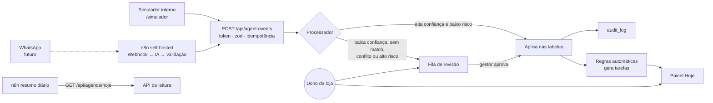
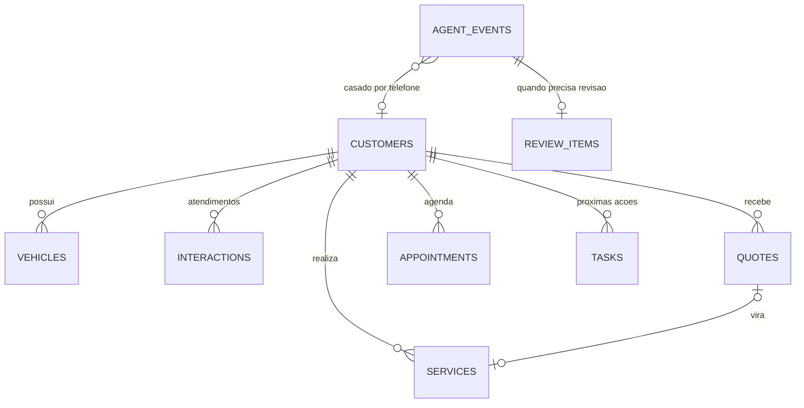

# Plano de Desenvolvimento — Central de Clientes (Loja de Pneus)

> Processo seletivo de estágio — Grupo Virtù · Autor: Caio Ribeiro Pereira
> Entrega: **sexta-feira, 16/10/2026** · Base: `virtuvito/projetos` → `sistema_atendimento_pneus` (commit `1609d51`)
> Documento de referência para o desenvolvimento com Claude Code. Diagnóstico completo em `docs/DIAGNOSTICO.md`.

---

## 0. Como usar este documento (instruções para o Claude Code)

- Este é o documento-fonte do projeto. Antes de cada fase, releia as seções citadas no prompt da fase (§16).
- Trabalhe **uma fase por vez**. Ao final de cada fase: rode lint, typecheck e testes; faça commits pequenos; atualize `DECISOES.md`; me mostre um resumo curto do que foi feito e do que ficou pendente.
- Se algo aqui estiver errado ou inviável, **pare e me avise** com uma proposta. Não improvise mudanças de escopo.
- Explique o código importante de forma que eu (dev júnior) consiga defender cada decisão numa entrevista.
- Restrição absoluta: **custo zero** (nada pago, nada que exija cartão de crédito).

---

## 1. Contexto e objetivo

O ponto de partida é um protótipo gerado pela plataforma ChatGPT Sites: visual bem acabado, mas com API sem autenticação, dados de cada cliente em um único JSON, toda a interface em um arquivo e sem testes.

**Objetivo do desafio:** permitir que o **dono da loja** acompanhe clientes, consulte o histórico de atendimentos e serviços e planeje ações futuras (retornos comerciais, acompanhamento de orçamentos, pós-venda). O sistema será atualizado por **agentes de IA** a partir de conversas de WhatsApp; deve recebê-las e apresentá-las de forma organizada. Na demo: dados fictícios, sem WhatsApp real. Acessibilidade e uso no celular e no desktop são prioridade.

**Avaliação:** autonomia, decisões de produto, qualidade da implementação, utilidade para o dono.

**Tese do produto (uma frase):** o dono abre o sistema no celular e, em 10 segundos, sabe **quem precisa ser contatado hoje e por quê** — e tudo o que o agente de IA descobriu nas conversas já está lá, com o que é incerto separado para ele decidir.

---

## 2. Decisões

| # | Decisão | Por quê | Status |
|---|---|---|---|
| D1 | Repositório **privado próprio**, copiando apenas a pasta `sistema_atendimento_pneus` | O repo da Virtù guarda projetos de clientes reais; evita risco de push indevido; histórico de commits mostra meu processo; segredos e deploy ficam sob meu controle | Decidido |
| D2 | **Next.js real (última 16.x estável, ≥ 16.3.8) + Vercel + Neon (Postgres) + Drizzle**, saindo de vinext (beta) + Workers + D1 | Stack que domino e consigo defender; vinext está em beta; o limite de 10 ms de CPU do Workers Free é risco para SSR; a pasta `app/` e o visual são reaproveitados | Decidido (validar no spike da Fase 0) |
| D3 | Manter identidade visual (paleta verde, tipografia); **reescrever** modelo de dados, API, telas e CSS | O que existia de bom era a aparência; o que impedia o objetivo era o miolo | Decidido |
| D4 | Login com **senha única do gestor** (cookie `httpOnly` assinado); endpoint dos agentes com **token próprio** | Proteger dados pessoais sem complexidade de multiusuário | Decidido |
| D5 | Modelo **normalizado** (tabelas por entidade) + `audit_log` gravado só pelo servidor | Agentes e gestor alteram entidades diferentes sem conflito; histórico confiável | Decidido |
| D6 | **"IA sugere, gestor decide no que mexe com dinheiro"**: alta confiança aplica só mudanças de baixo risco; o resto vai para a fila de revisão | Confiança do dono no sistema; evita erro caro de extração | Decidido |
| D7 | Persona **"Vito"** como nome do agente de IA na interface | Já existe no protótipo; dá rosto à automação | Decidido |
| D8 | **Simulador interno** é o caminho principal da demo; **n8n** é bônus demonstrável | Avaliadores conseguem usar o simulador pelo link; o n8n roda local | Decidido |
| D9 | IA no n8n: **Gemini (plano gratuito) só com dados fictícios**; Ollama documentado como alternativa "dados não saem da loja" | Plano gratuito do Gemini usa o conteúdo para melhorar produtos; notebook sem GPU deixa o Ollama lento | Decidido |
| D10 | Seed **relativo a hoje** + botão **"Reiniciar demonstração"** | A demo original "envelhece" e parece toda atrasada | Decidido |
| D11 | Datas: `timestamptz` em UTC no banco; exibição e regras de "hoje" em `America/Sao_Paulo` | Corrige o bug de hora no histórico e evita "vencido" errado | Decidido |
| D12 | Deploy pela **CLI da Vercel** (`vercel deploy`) | Funciona sem precisar de permissões especiais no GitHub | Decidido |
| D13 | Onde publicar e como entregar o código | — | **Aguardando Virtù** (padrão: Vercel na minha conta + repo privado com acesso para eles) |

Toda nova decisão relevante vai para `DECISOES.md` no formato: contexto → opções → escolha → motivo.

---

## 3. Escopo

### MUST (sem isso não entrego)
1. Login do gestor e proteção de todas as rotas e APIs.
2. Modelo de dados normalizado com migrations e seed relativo a hoje.
3. **Painel "Hoje"** como tela inicial (§7).
4. **Clientes**: lista com busca normalizada e filtros; cadastro e edição.
5. **Ficha do cliente** com linha do tempo unificada e próximas ações.
6. **`POST /api/agent-events`** com token, validação, idempotência, matching por telefone, regra de confiança e auditoria (§8).
7. **Fila de revisão** (aprovar, editar e aprovar, rejeitar).
8. **Simulador** de conversas que usa o mesmo endpoint, e botão "Reiniciar demonstração".
9. Acessibilidade WCAG 2.1 AA nas telas principais e layout mobile-first (§10).
10. Testes (§13), deploy funcionando, README, `docs/AGENTES_IA.md`, `RESUMO_ENTREGA.md`.

### SHOULD
11. Workflows n8n exportados (extração de conversa e resumo diário) + `GET /api/agenda/hoje`.
12. Excluir cliente (LGPD) com registro anonimizado na auditoria.
13. Links `wa.me` com mensagem pronta por tipo de ação.

### COULD
14. Regra de cliente inativo (180 dias).
15. Indicadores simples (orçamentos em aberto, conversão do mês).

### WON'T (citar como próximos passos)
- Integração real com WhatsApp, multiusuário com papéis, Kanban arrastável, gráficos, exportação CSV, chat simulado, Agenda como tela própria (agendamentos aparecem no "Hoje" e na ficha).

---

## 4. Arquitetura



- Next.js App Router: Server Components para leitura; **Server Actions** para ações do gestor; **Route Handlers** apenas para integrações externas (`/api/agent-events`, `/api/agenda/hoje`).
- Lógica de negócio em `lib/` (pura e testável), nunca dentro de componentes.

### Estrutura de pastas alvo
```
app/
  (auth)/login/page.tsx
  (app)/layout.tsx              # navegação: barra inferior no celular, lateral no desktop
  (app)/hoje/page.tsx
  (app)/clientes/page.tsx
  (app)/clientes/novo/page.tsx
  (app)/clientes/[id]/page.tsx
  (app)/revisao/page.tsx
  (app)/simulador/page.tsx
  api/agent-events/route.ts
  api/agenda/hoje/route.ts
components/                     # componentes de tela + ui/ (só os shadcn usados)
db/schema.ts · db/index.ts · db/seed.ts · drizzle/ (migrations)
lib/
  dates.ts                      # fuso, "hoje", formatação
  phone.ts                      # normalização E.164
  search.ts                     # busca sem acento / dígitos / placa
  rules/today.ts                # montagem do painel Hoje
  rules/auto-tasks.ts           # regras que geram tarefas
  agent/schema.ts               # contrato zod dos eventos
  agent/process.ts              # pipeline de processamento
  auth.ts · audit.ts
simulator/presets/*.json        # conversas fictícias
infra/n8n/                      # docker-compose, workflows exportados, README
tests/                          # unit, integration, e2e
docs/ (DIAGNOSTICO.md, AGENTES_IA.md, screenshots)
```

---

## 5. Stack e ferramentas

| Camada | Escolha |
|---|---|
| Framework | Next.js 16.x (≥ 16.3.8), React 19, TypeScript strict |
| UI | Tailwind 4, shadcn/ui (apenas componentes usados), lucide-react, sonner |
| Banco | Neon Postgres (plano gratuito) via `@neondatabase/serverless` + Drizzle ORM/kit |
| Validação | zod (tipos derivados com `z.infer`, sem duplicar tipos) |
| Telefone | `libphonenumber-js` |
| Testes | Vitest + PGlite (Postgres em memória, para integração), Playwright + `@axe-core/playwright` |
| Qualidade | ESLint, Prettier, `tsc --noEmit` |
| Deploy | Vercel (Hobby) via CLI |
| Agentes | n8n self-hosted (Docker) + Gemini (plano gratuito) |

**Remover do projeto original:** vinext, Vite, `@cloudflare/*`, wrangler, `build/sites-vite-plugin.ts`, `.openai/`, `scripts/` da plataforma Sites, `examples/`, `app/chatgpt-auth.ts`, os 50 componentes shadcn sem uso, dependências sem uso (lista em `docs/DIAGNOSTICO.md` §7) e a ferramenta WebMCP.

**Variáveis de ambiente** (todas em `.env.example`):
`DATABASE_URL`, `GESTOR_PASSWORD`, `SESSION_SECRET`, `AGENT_API_TOKEN`, `APP_TIMEZONE=America/Sao_Paulo`, `AGENT_AUTO_APPLY_THRESHOLD=0.85`.

---

## 6. Modelo de dados

Convenções: `id uuid` gerado no servidor; `created_at`/`updated_at timestamptz`; campos de origem `source ('gestor' | 'agente' | 'sistema')` e `agent_event_id` (nullable) em toda entidade que o agente pode criar.



### customers
| Campo | Tipo | Observação |
|---|---|---|
| id | uuid PK | |
| name | text | obrigatório |
| phone_e164 | text UNIQUE | ex.: `+5519988887777`; nullable só para provisórios sem telefone |
| phone_display | text | como foi informado |
| email, city | text | opcionais |
| origin | enum | `whatsapp`, `indicacao`, `balcao`, `instagram`, `google`, `outro` |
| stage | enum | `novo_contato`, `em_negociacao`, `orcamento_enviado`, `agendado`, `cliente`, `perdido` |
| loss_reason | text | obrigatório quando `perdido` |
| notes | text | |
| is_provisional | boolean | criado pelo agente sem confirmação |
| human_edited_fields | text[] | campos que o gestor alterou (para detectar conflito com o agente) |
| version | int | trava otimista |
| source, agent_event_id, created_at, updated_at | | |

### vehicles
`id`, `customer_id FK (cascade)`, `plate` (normalizada, maiúscula, sem traço), `model`, `year`, `tire_size` (ex.: `205/55 R16`), `notes`, origem, datas.

### interactions (atendimentos)
`id`, `customer_id`, `channel` (`whatsapp`, `telefone`, `balcao`), `occurred_at`, `summary` (resumo, nunca a conversa inteira), `evidence` (trecho curto, opcional), origem.

### quotes (orçamentos)
`id`, `customer_id`, `vehicle_id?`, `description`, `tire_size?`, `quantity?`, `total numeric(10,2)`, `status` (`rascunho`, `enviado`, `aprovado`, `recusado`, `expirado`), `sent_at?`, `valid_until?`, `responded_at?`, `loss_reason?`, origem.

### services
`id`, `customer_id`, `vehicle_id?`, `quote_id?`, `type` (`troca_pneus`, `alinhamento`, `balanceamento`, `rodizio`, `reparo`, `outro`), `description`, `performed_at`, `total?`, `km?`, origem.

### appointments (agendamentos)
`id`, `customer_id`, `vehicle_id?`, `scheduled_at`, `service_type`, `status` (`agendado`, `confirmado`, `concluido`, `cancelado`, `nao_compareceu`), origem.

### tasks (próximas ações)
| Campo | Observação |
|---|---|
| type | `retorno_comercial`, `followup_orcamento`, `pos_venda`, `confirmar_agendamento`, `outro` |
| title, reason | reason = "por quê" em linguagem simples, mostrado no card |
| due_date | `date` (dia da loja, fuso `America/Sao_Paulo`) |
| status | `pendente`, `concluida`, `cancelada` |
| snoozed_count | quantas vezes foi adiada |
| quote_id?, service_id?, appointment_id? | vínculo com a origem |
| auto_rule? | nome da regra que gerou (ex.: `R1`) |
| | **UNIQUE (auto_rule, quote_id, service_id)** garante que a regra não duplique tarefa |
| completed_at, origem | |

### agent_events
`id`, `event_id UNIQUE`, `schema_version`, `type`, `conversation_id`, `agent_name`, `model`, `prompt_version`, `confidence numeric(3,2)`, `evidence`, `payload jsonb`, `received_at`, `status` (`aplicado`, `em_revisao`, `duplicado`, `rejeitado`, `erro`), `result jsonb` (ids criados ou erros), `customer_id?`.

### review_items
`id`, `agent_event_id FK`, `reason` (`baixa_confianca`, `cliente_nao_encontrado`, `varios_clientes`, `conflito_edicao_humana`, `alto_impacto`), `proposed jsonb`, `status` (`pendente`, `aprovado`, `aprovado_editado`, `rejeitado`), `decided_at`, `note`.

### audit_log
`id`, `entity_type`, `entity_id`, `action` (`create`, `update`, `delete`, `review_decision`), `actor_type` (`gestor`, `agente`, `sistema`), `agent_event_id?`, `before jsonb`, `after jsonb`, `at`. Gravado **somente no servidor**, na mesma transação da mudança. Na exclusão de cliente (LGPD), registrar só `entity_id` e ação, sem dados pessoais.

---

## 7. Regras de negócio

### 7.1 Regras automáticas de tarefas (`lib/rules/auto-tasks.ts`)

Executadas de forma idempotente (graças ao UNIQUE) sempre que o painel "Hoje" é carregado e após cada evento aplicado. Não dependem de cron.

| Regra | Condição | Tarefa gerada | Vencimento |
|---|---|---|---|
| **R1** Follow-up de orçamento | orçamento `enviado` sem resposta | `followup_orcamento` — "Orçamento de R$ X enviado há N dias sem resposta" | `sent_at + 3 dias` |
| **R2** Pós-venda | serviço registrado | `pos_venda` — "Perguntar se ficou tudo certo com o serviço" | `performed_at + 7 dias` |
| **R3** Retorno comercial | serviço `troca_pneus` ou `alinhamento` | `retorno_comercial` — "Oferecer rodízio e alinhamento" | `performed_at + 180 dias` |
| **R4** Confirmar agendamento | agendamento `agendado` para amanhã | `confirmar_agendamento` | dia anterior ao agendamento |
| R5 (COULD) Cliente inativo | sem interação há 180 dias e sem tarefa pendente | `retorno_comercial` — "Reativar cliente" | hoje |

Quando a condição deixa de valer (ex.: orçamento aprovado), a tarefa automática pendente é **cancelada** automaticamente, com registro na auditoria.

Prazos ficam em constantes em `lib/rules/config.ts`, para ajuste fácil.

### 7.2 Painel "Hoje" (`lib/rules/today.ts`)

Seções, nesta ordem (seções vazias não aparecem):

1. **Faixa "Revisar sugestões do Vito (N)"** — se houver itens pendentes na fila.
2. **Atrasados** — tarefas pendentes com `due_date < hoje`, ordenadas da mais antiga.
3. **Para hoje** — tarefas com `due_date = hoje` + agendamentos de hoje (por horário).
4. **Próximos 7 dias** — recolhida por padrão.
5. **Tudo em dia** — estado vazio positivo quando não houver nada.

Cada card mostra: nome do cliente, **motivo em linguagem simples**, há quantos dias está atrasado, selo "via Vito" quando veio do agente. Ações (alvos ≥ 44 px):
- **WhatsApp** (link `wa.me` com mensagem pronta conforme o tipo);
- **Concluir** (com desfazer por 5 s no toast);
- **Adiar** (amanhã, +3 dias, escolher data);
- toque no card abre a ficha.

"Hoje" é calculado em `America/Sao_Paulo`: às 23:30 de terça em Brasília ainda é terça, mesmo já sendo quarta em UTC.

### 7.3 Busca de clientes (`lib/search.ts`)
Sem diferenciar acento ou maiúsculas ("andre" encontra "André"); telefone por dígitos ("1998888" encontra "(19) 98888-7777"); placa sem traço ("abc1d23" encontra "ABC-1D23").

---

## 8. Contrato dos eventos dos agentes

### 8.1 Envelope (`lib/agent/schema.ts`, zod com união discriminada por `type`)

```json
{
  "schema_version": "1.0",
  "event_id": "wa-conv-123-msg-456-quote.created",
  "type": "quote.created",
  "occurred_at": "2026-10-14T13:05:00-03:00",
  "source": {
    "channel": "whatsapp",
    "conversation_id": "conv-123",
    "message_ids": ["msg-455", "msg-456"]
  },
  "agent": { "name": "vito-extrator", "model": "gemini", "prompt_version": "2026-10-14" },
  "confidence": 0.92,
  "evidence": "Cliente: fechado então os 4 pneus 205/55 R16 por 1.840?",
  "customer": { "phone": "(19) 98888-7777", "name": "Ricardo Alves" },
  "data": { }
}
```

Limites: `event_id` 8–128 caracteres; `evidence` ≤ 500 caracteres; corpo ≤ 64 KB.

### 8.2 Tipos de evento e `data`

| type | data | Risco |
|---|---|---|
| `customer.upserted` | `name?`, `email?`, `city?`, `origin?` | baixo (só preenche campos vazios) |
| `vehicle.identified` | `plate?`, `model?`, `year?`, `tire_size?` | baixo |
| `interaction.logged` | `summary`, `channel` | baixo |
| `quote.created` | `description`, `total`, `tire_size?`, `quantity?`, `valid_until?`, `vehicle_plate?` | baixo (cria `enviado`) |
| `task.suggested` | `type`, `title`, `reason`, `due_date` | baixo |
| `appointment.requested` | `scheduled_at`, `service_type` | baixo (cria `agendado`; R4 pede confirmação) |
| `quote.status_changed` | `status` (`aprovado` ou `recusado`), `reason?`, `quote_id?` (se ausente: último orçamento `enviado` do cliente) | **alto** |
| `service.completed` | `type`, `description`, `performed_at`, `total?`, `km?` | **alto** |

### 8.3 Processamento (`lib/agent/process.ts`)

1. **Autenticação:** `Authorization: Bearer <AGENT_API_TOKEN>`, comparado em tempo constante → `401`.
2. **Validação zod** → `422` com a lista de campos inválidos.
3. **Idempotência:** `INSERT INTO agent_events … ON CONFLICT (event_id) DO NOTHING`. Se já existia → `200 {status: "duplicate"}`, sem efeito.
4. **Matching:** normaliza telefone para E.164 (padrão BR).
   - 1 cliente → segue;
   - 0 → se baixo risco e confiança ≥ limiar, cria cliente **provisório**; senão, revisão (`cliente_nao_encontrado`);
   - mais de 1 → revisão (`varios_clientes`).
5. **Decisão:**
   - aplica automaticamente **somente se** confiança ≥ `AGENT_AUTO_APPLY_THRESHOLD` (0,85) **e** o tipo é de baixo risco **e** não sobrescreve campo em `human_edited_fields`;
   - tipos de alto risco **sempre** vão para revisão (`alto_impacto`), com a confiança exibida;
   - conflito com edição humana → revisão (`conflito_edicao_humana`).
6. **Aplicação** em transação: grava a entidade, `audit_log`, status do evento e roda as regras automáticas (§7.1).

### 8.4 Respostas

| Situação | HTTP | Corpo |
|---|---|---|
| Aplicado | 201 | `{ "status": "applied", "event_id", "applied": [{ "entity": "quote", "id": "…" }] }` |
| Enviado para revisão | 202 | `{ "status": "queued_for_review", "event_id", "review_id", "reason" }` |
| Duplicado | 200 | `{ "status": "duplicate", "event_id" }` |
| Token inválido | 401 | `{ "error": "unauthorized" }` |
| Payload inválido | 422 | `{ "error": "invalid_payload", "issues": [...] }` |

### 8.5 `GET /api/agenda/hoje` (SHOULD)
Mesmo token. Retorna o painel "Hoje" resumido em JSON (contagens + itens com nome, motivo e tipo), para o workflow de resumo diário do n8n.

---

## 9. Telas e critérios de aceite

Navegação: **barra inferior no celular** (Hoje · Clientes · Revisão com contador · Mais) e **barra lateral no desktop**. Cada tela e cada cliente têm URL própria (o "voltar" do celular funciona).

### Login (`/login`)
- [ ] Campo de senha com rótulo visível; erro anunciado ao leitor de tela.
- [ ] Sessão em cookie `httpOnly`, `secure`, `sameSite=lax`, assinado; expira em 7 dias.
- [ ] Toda rota em `(app)` e toda Server Action exige sessão.

### Hoje (`/hoje`)
- [ ] Seções e ordem conforme §7.2; motivo legível em cada card.
- [ ] Concluir, adiar e WhatsApp funcionam em 1 toque, com feedback e desfazer.
- [ ] Em 375 px, a primeira ação aparece sem rolar.
- [ ] Estado vazio "Tudo em dia".

### Clientes (`/clientes`)
- [ ] **Cards no celular**, tabela no desktop; nenhuma rolagem horizontal.
- [ ] Busca conforme §7.3; filtros "Precisa de ação" e por etapa (com rótulo acessível).
- [ ] Selo para clientes provisórios criados pelo Vito.

### Novo / editar cliente
- [ ] Telefone validado e normalizado; aviso se já existir cliente com o mesmo telefone (com link).
- [ ] Erros por campo, ligados via `aria-describedby`.
- [ ] Ao salvar, registra os campos alterados em `human_edited_fields`.
- [ ] Conflito de versão (409): mensagem com botão "Ver versão atual" e reaplicar, sem perder o que foi digitado.

### Ficha do cliente (`/clientes/[id]`)
- [ ] Cabeçalho: nome, telefone com botões WhatsApp e Ligar, etapa.
- [ ] Resumo: veículos, orçamento em aberto, próxima ação.
- [ ] **Linha do tempo unificada** (atendimentos, orçamentos, serviços, agendamentos, tarefas, decisões de revisão), mais recente primeiro, hora correta em Brasília, filtro por tipo.
- [ ] Itens vindos do agente com selo "via Vito" e evidência expansível.
- [ ] Ações rápidas: nova tarefa, novo orçamento, registrar serviço, novo agendamento.
- [ ] Excluir cliente (SHOULD) com confirmação digitando o nome.

### Revisão (`/revisao`)
- [ ] Lista de pendentes com motivo, confiança, evidência e **proposta lado a lado com o dado atual**.
- [ ] Aprovar, editar e aprovar, rejeitar (com nota opcional); decisão grava auditoria e atualiza o evento.
- [ ] Para "cliente não encontrado": associar a um cliente existente (busca) ou criar novo.

### Simulador (`/simulador`)
- [ ] 5 a 6 conversas fictícias pré-prontas (ver §12.3), exibidas como chat.
- [ ] Botão "Processar com o Vito" mostra o(s) evento(s) JSON que seriam gerados, envia ao **mesmo endpoint** pelo servidor (token nunca vai ao navegador) e mostra a resposta com link para o resultado (ficha ou fila).
- [ ] Botão "Enviar de novo" demonstra a idempotência (`duplicate`).
- [ ] Editor de JSON livre para testar eventos customizados.
- [ ] Botão "Reiniciar demonstração" recria o seed relativo a hoje (com confirmação).
- [ ] Texto curto explicando que, em produção, o n8n faz esse papel.

---

## 10. Diretrizes visuais e acessibilidade

**Princípio:** manter a identidade e melhorar legibilidade e hierarquia. Visual mais limpo, com o urgente em destaque.

### Tokens de cor (validar com axe; ajustar se necessário)

| Token | Valor | Uso | Contraste sobre branco |
|---|---|---|---|
| `--bg` | `#F6F7F4` | fundo da página | — |
| `--surface` | `#FFFFFF` | cards | — |
| `--text` | `#1C2118` | texto principal | ~16:1 |
| `--text-muted` | `#4F5747` | texto secundário | ~7:1 |
| `--primary` | `#3F6B12` | botões e links (texto branco sobre ele) | ~6:1 |
| `--brand` | `#83B834` | **só decorativo** (nunca texto nem borda funcional) | 2,4:1 |
| `--border-input` | `#7A8270` | bordas de campos e checkbox | ~4:1 (≥ 3:1) |
| `--danger` | `#B42318` | atrasado, erro | ~6:1 |
| `--warning-text` | `#8A4B00` | "vence hoje" | ~6:1 |
| `--focus` | `#3F6B12` | anel de foco 2 px + offset 2 px | ~6:1 |

Status nunca só por cor: sempre com texto e/ou ícone.

### Tipografia e espaçamento
- Base 16 px; mínimo 14 px; nada de 10 a 12 px em informação relevante. `line-height` 1,5. Números tabulares em valores e datas.
- Alvos de toque ≥ 44×44 px (checkbox, menu, fechar modal, ações dos cards).

### Checklist AA (por tela)
- [ ] HTML semântico: `header`, `nav` com `aria-label`, `main`, um `h1` por tela, headings sem pular nível.
- [ ] Todo campo e todo select com rótulo (visível ou `aria-label`); nada rotulado só por placeholder.
- [ ] Foco visível em tudo (remover o `outline:none` da busca); ordem de tab lógica; regiões roláveis focáveis.
- [ ] Textos de interface em pt-BR (trocar "Close", "Toggle Sidebar" etc.).
- [ ] Toasts e erros anunciados (`aria-live`).
- [ ] Zoom de 200% sem perda de conteúdo; sem rolagem horizontal em 320 px.
- [ ] axe sem violações e Lighthouse acessibilidade ≥ 95 em `/hoje`, `/clientes`, `/clientes/[id]`, `/revisao`, `/simulador`, em 375 px e 1280 px.

---

## 11. Segurança e LGPD

- Sessão do gestor obrigatória em todas as rotas e ações; token separado para agentes; segredos só em variáveis de ambiente.
- Cabeçalhos: CSP básica, `X-Content-Type-Options: nosniff`, `Referrer-Policy: strict-origin-when-cross-origin`, `frame-ancestors 'none'`.
- Server Actions já trazem proteção contra CSRF do Next; route handlers aceitam só JSON.
- **Minimização:** guardar resumo e trecho curto de evidência, nunca a conversa inteira.
- **Exclusão** de cliente com cascata (SHOULD).
- Logs sem payload nem dados pessoais.
- `pnpm audit` sem vulnerabilidades altas ou críticas em dependências de runtime.
- Documentar no `docs/AGENTES_IA.md`: dados reais exigiriam base legal, aviso sobre uso de IA, retenção definida e provedor de IA que não use os dados para treino (ou Ollama local).

---

## 12. Camada de agentes (n8n) — SHOULD

### 12.1 Workflow `extracao-conversa`
Webhook (conversa fictícia) → nó de IA (Gemini, plano gratuito) com Structured Output Parser no formato do §8 → nó Code (valida, normaliza telefone, gera `event_id = sha256(conversation_id + último message_id + type)`; JSON inválido: 1 nova tentativa, depois envia com `confidence` baixa) → HTTP Request para `POST /api/agent-events` com o token (credencial do n8n).

### 12.2 Workflow `resumo-diario`
Schedule Trigger (7h45, `America/Sao_Paulo`) → `GET /api/agenda/hoje` → mensagem curta ("3 atrasados, 2 orçamentos parados…") → e-mail (SMTP gratuito) ou bot do Telegram.

### 12.3 Conversas fictícias (usadas pelo simulador e pelo n8n)
1. Cliente novo pede orçamento de 4 pneus → `customer.upserted`, `vehicle.identified`, `quote.created`.
2. Cliente aprova orçamento enviado há 4 dias → `quote.status_changed` (alto impacto → revisão).
3. Cliente agenda alinhamento para sábado → `appointment.requested`.
4. Cliente reclama de barulho após a troca → `interaction.logged` + `task.suggested` (pós-venda urgente).
5. Mensagem ambígua de número desconhecido ("vcs tem aro 15?") → baixa confiança → revisão.
6. Mesma conversa reenviada → `duplicate`.

### 12.4 Entregáveis
`infra/n8n/docker-compose.yml`, `infra/n8n/workflows/*.json` (sem credenciais — conferir antes do commit), `infra/n8n/README.md` com passo a passo e exemplos `curl`. Demonstração ao vivo na entrevista; prints no README.

---

## 13. Testes

| Tipo | O quê | Ferramenta |
|---|---|---|
| Unidade | `phone.ts`, `search.ts`, `dates.ts` (inclui 23:30 de Brasília × UTC), regras R1–R4, montagem do "Hoje" | Vitest |
| Unidade | schema zod: cada tipo válido + casos inválidos | Vitest |
| Integração | `process.ts` com banco PGlite: token, 422, idempotência, matching 0/1/N, limiar de confiança, alto impacto, conflito com edição humana, auditoria gravada | Vitest + PGlite |
| Integração | trava otimista (409) | Vitest + PGlite |
| E2E | fumaça: login → Hoje → concluir ação → ficha → linha do tempo; simulador → revisão → aprovar → aparece na ficha | Playwright |
| Acessibilidade | axe nas 5 telas principais, 375 e 1280 px | `@axe-core/playwright` |
| Manual | teclado só, leitor de tela (NVDA) no fluxo principal, celular real, zoom 200% | registro em `RESUMO_ENTREGA.md` |

Scripts no `package.json`: `test`, `test:e2e`, `lint`, `typecheck`, `format`, `db:generate`, `db:migrate`, `db:seed`.

---

## 14. Deploy

1. Neon: criar projeto gratuito → `DATABASE_URL`.
2. Vercel: `vercel link` e `vercel env add` para cada variável → `vercel deploy --prod`.
3. Rodar migrations e seed contra o banco de produção.
4. Validar no celular e no desktop; rodar Lighthouse na URL pública.
5. Registrar limites no `DECISOES.md` (Neon suspende quando ocioso: primeira requisição pode levar alguns segundos).

Confirmar nas páginas oficiais que os planos continuam gratuitos e sem cartão, e que os termos do Vercel Hobby cobrem o uso.

---

## 15. Cronograma

| Quando | Fase | Pronto quando |
|---|---|---|
| **Ter 13/10, noite** | **0 — Base e spike** | Repo privado com snapshot original; projeto migrado para Next; página + consulta ao Neon **no ar na Vercel** |
| **Qua 14/10, manhã** | **1 — Dados** | Schema, migrations, seed relativo a hoje, `lib/dates`, `lib/phone`, `lib/search` com testes |
| **Qua 14/10, tarde** | **2 — Núcleo** | Auth; `/api/agent-events` completo; regras R1–R4 e "Hoje" em `lib/`; testes de integração passando |
| **Qui 15/10, manhã** | **3 — Telas principais** | Layout, navegação, tokens; Hoje; Clientes; Ficha com linha do tempo |
| **Qui 15/10, tarde** | **4 — Revisão e simulador** | Fila de revisão, simulador, reiniciar demo; E2E e axe passando |
| **Sex 16/10, manhã** | **5 — Bônus e entrega** | n8n (se der), passe final de acessibilidade, docs, deploy final, Lighthouse |
| **Sex 16/10, tarde** | Margem | Envio à Virtù até 17h |
| Qualquer folga | **Extras** | Itens do §19, em ordem, só com o MUST pronto e no ar |

**Cortes, nesta ordem, se atrasar:** R5 e indicadores → resumo diário do n8n → exclusão LGPD → workflow de extração do n8n (fica só o simulador) → editor de JSON livre do simulador.

**Plano B do deploy:** se o spike da Fase 0 falhar em até 1 hora, registrar o motivo e avaliar Render + Neon ou manter Workers + D1, conforme `docs/DIAGNOSTICO.md` §12.

---

## 16. Prompts por fase (colar no Claude Code)

**Fase 0**
```
Leia PLANO_DESENVOLVIMENTO.md (§0, §2, §4, §5, §14) e docs/DIAGNOSTICO.md. Execute a Fase 0:
1. Prepare o projeto para um repositório próprio: só a pasta do sistema, primeiro commit "chore: snapshot original (virtuvito/projetos@1609d51)" sem nenhuma alteração.
2. Migre de vinext/Workers/D1 para Next.js 16.x (≥ 16.3.8) com Drizzle + Neon, removendo tudo listado em §5. Mantenha globals.css e o visual por enquanto.
3. Crie .env.example, scripts do §13, ESLint + Prettier, DECISOES.md (D1–D13).
4. Crie uma página de saúde que consulte o banco e me guie no deploy na Vercel pela CLI.
Pare quando a URL estiver no ar e me mostre o resumo.
```

**Fase 1**
```
Execute a Fase 1 conforme §6, §7.3 e §13 do PLANO_DESENVOLVIMENTO.md: schema Drizzle completo, migrations, seed fictício coerente e relativo a hoje (≈15 clientes cobrindo todas as regras R1–R4, itens atrasados, para hoje, próximos dias, provisório e itens na fila de revisão), lib/dates, lib/phone, lib/search com testes Vitest. Commits pequenos. Pare e me mostre o resumo.
```

**Fase 2**
```
Execute a Fase 2 conforme §7, §8, §11 e §13: autenticação do gestor, lib/agent/schema.ts, lib/agent/process.ts, POST /api/agent-events, regras automáticas e montagem do "Hoje" em lib/rules, auditoria. Testes de integração com PGlite cobrindo todos os casos do §13. Explique o pipeline do §8.3 de forma que eu consiga defender. Pare e me mostre o resumo.
```

**Fase 3**
```
Execute a Fase 3 conforme §9 (Login, Hoje, Clientes, Novo/editar, Ficha) e §10: layout mobile-first com navegação inferior/lateral, tokens de cor, componentes acessíveis. Use Server Components e Server Actions; lógica só em lib/. Rode axe nas telas prontas. Pare e me mostre screenshots em 375 e 1280 px.
```

**Fase 4**
```
Execute a Fase 4 conforme §9 (Revisão e Simulador) e §12.3 (conversas fictícias como presets em simulator/presets). O simulador deve chamar o endpoint pelo servidor, sem expor o token. Escreva os testes E2E e de acessibilidade do §13 e corrija o que falhar. Pare e me mostre o resumo.
```

**Fase 5**
```
Execute a Fase 5: §12 (n8n) se houver tempo, passe final do checklist do §10, Lighthouse nas telas principais, deploy final (§14). Escreva README.md, docs/AGENTES_IA.md (fluxo com diagrama Mermaid, contrato, exemplos de payload, como ajuda o gestor) e RESUMO_ENTREGA.md (§17). Confira que nenhum segredo está no repositório.
```

**Extras (só com tudo acima pronto e no ar)**
```
Releia o §19 do PLANO_DESENVOLVIMENTO.md e confirme que a regra de entrada está cumprida (MUST pronto, testes passando, deploy ok). Se estiver, faça o próximo item da lista ainda não marcado, um por vez, com commit próprio e respeitando o limite de ~1h30 por item. Ao final de cada um, atualize RESUMO_ENTREGA.md e me diga qual seria o próximo.
```

---

## 17. Entregáveis (checklist final)

- [ ] **Código** no repositório (privado, com acesso para a Virtù), histórico de commits limpo.
- [ ] **Link** do sistema funcionando + senha da demo no README.
- [ ] `RESUMO_ENTREGA.md`: melhorias (antes × depois, com prints), decisões principais, testes realizados com resultados (unidade, integração, E2E, axe, Lighthouse antes × depois, testes manuais), limitações e próximos passos.
- [ ] `docs/AGENTES_IA.md`: como as informações dos agentes entram no sistema e ajudam o gestor a acompanhar clientes e planejar os próximos passos.
- [ ] `DECISOES.md` atualizado.
- [ ] Workflows n8n exportados (se feitos) e roteiro de demonstração ao vivo.

---

## 18. Riscos

| Risco | Mitigação |
|---|---|
| Migração para Next demorar | Spike com prazo de 1 h na Fase 0; plano B no §15 |
| Neon "acordando" lento na demo | Abrir o sistema minutos antes; documentar |
| Escopo grande para 2,5 dias | Ordem de cortes no §15; MUST primeiro |
| IA gerar JSON inválido no n8n | Structured Output Parser + validação + retry; simulador não depende disso |
| Código gerado que não sei explicar | Pedir explicação ao fim de cada fase; ler endpoint, regras e auth linha a linha |
| Respostas pendentes da Virtù (D13) | Seguir o padrão definido e ajustar só o passo de deploy/entrega |

---

## 19. Se der tempo, faça

**Regra de entrada:** só comece um item desta lista quando **todo o MUST (§3) estiver pronto, testado e no ar**, e os testes estiverem passando. Faça na ordem abaixo, um item por vez, com commit próprio. Se um item passar de ~1h30 sem terminar, pare, reverta para o último commit estável e registre no `DECISOES.md`.

| # | Item | Valor para o dono / para a avaliação | Esforço |
|---|---|---|---|
| T1 | **Workflow n8n de extração** (§12.1) com prints no README | Mostra a camada de agentes funcionando de verdade | médio |
| T2 | **Workflow n8n de resumo diário** (§12.2) + `GET /api/agenda/hoje` | O dono recebe o dia pronto sem abrir o sistema | baixo |
| T3 | **Exclusão de cliente (LGPD)** com auditoria anonimizada | Mostra cuidado com dados pessoais | baixo |
| T4 | **App instalável (PWA)**: manifest, ícone, "Adicionar à tela inicial" | O dono abre como um app no celular | baixo |
| T5 | **Registro rápido de atendimento** a partir do card do "Hoje" ("Falei com ele: …" + próxima ação em 1 tela) | Fecha o ciclo da ação sem abrir a ficha | médio |
| T6 | **Modelos de mensagem editáveis** para os links de WhatsApp (por tipo de tarefa) | Cada loja fala do seu jeito | baixo |
| T7 | **R5 — cliente inativo** (§7.1) | Recupera clientes esquecidos | baixo |
| T8 | **Indicadores simples** no topo do "Hoje" ou em "Mais": orçamentos em aberto (R$), conversão do mês, serviços da semana | Visão rápida do negócio | baixo |
| T9 | **CI no GitHub Actions** (plano gratuito): lint, typecheck e testes a cada push | Qualidade visível no repositório | baixo |
| T10 | **Modo escuro** usando os mesmos tokens, com contraste validado | Conforto visual | médio |
| T11 | **Vídeo curto da demo** (1–2 min, OBS + YouTube não listado) | Avaliador vê o n8n sem instalar nada | baixo |
| T12 | **Teste com Ollama local** documentando tempo e qualidade × Gemini | Argumento "dados não saem da loja" com números | médio |

Ao terminar cada item: atualizar `RESUMO_ENTREGA.md` (seção "Extras") e marcar aqui.

Itens que **não** entram nem se sobrar tempo (fogem do foco ou do prazo): integração real com WhatsApp, multiusuário com papéis, Kanban arrastável, gráficos elaborados.
