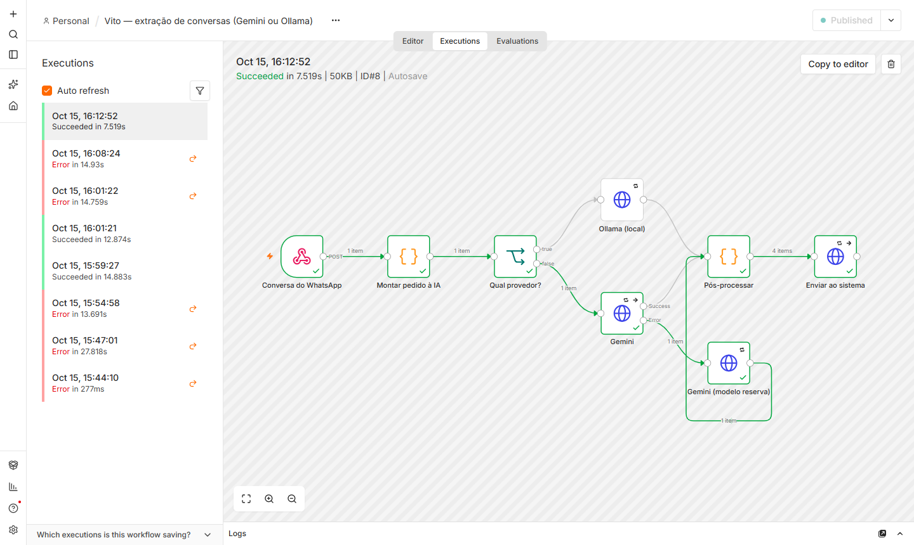

# Virtù Pneus — Central do gestor

Sistema para o dono de uma loja de pneus acompanhar clientes, orçamentos, agendamentos e o que
precisa ser feito **hoje**, alimentado pelas conversas do atendente de WhatsApp (o "Vito", um agente
de IA). Reconstrução do protótipo do desafio do Grupo Virtù, com o diagnóstico do original em
[`docs/DIAGNOSTICO.md`](docs/DIAGNOSTICO.md).

## Demonstração

- **Link:** https://virtu-pneus-central.vercel.app
- **Senha do gestor:** `virtu-aro-rodizio-485`
- **Simulador de conversas (teste):** https://virtu-pneus-central.vercel.app/simulador — ferramenta
  de demonstração, fora do menu do dono (D56). Também abre em **Mais → Ferramentas de teste**, numa
  nova aba. Use as duas abas lado a lado: o simulador numa, o sistema na outra.
- Dados 100% fictícios. No **Simulador → Reiniciar demonstração** os dados voltam ao estado
  inicial, com datas relativas ao dia de hoje.
- Roteiro sugerido (5 min):
  1. **Hoje:** ações do dia, agendamentos e orçamentos parados.
  2. **Simulador** (outra aba): envie "Cliente novo pede orçamento de 4 pneus"; na aba do sistema,
     atualize e veja o cliente provisório e o follow-up aparecerem.
  3. Envie "Cliente aprova orçamento enviado há dias": como mexe com dinheiro, vai para a
     **Revisão**. Aprove por lá.
  4. Envie "A mesma conversa chega de novo" e veja que **nada duplica**.

> O banco (Neon) hiberna sem uso: o primeiro acesso do dia pode levar alguns segundos.

## O que o sistema faz

| Tela | Para quê |
|---|---|
| **Hoje** | Ações vencidas e do dia (follow-up de orçamento, pós-venda, retorno, confirmar agendamento), agenda e orçamentos aguardando — com WhatsApp/ligar em um toque |
| **Clientes** | Busca tolerante (sem acento, telefone por dígitos, placa sem traço), ficha com veículos, orçamentos, linha do tempo e o que veio do Vito. Na ficha: registrar atendimento, próxima ação, orçamento (aprovar/recusar com motivo), serviço, agendamento (confirmar/cancelar) e veículo; a etapa do funil acompanha esses fatos |
| **Revisão** | O que a IA não pôde aplicar sozinha: confiança baixa, cliente desconhecido, dinheiro, conflito com edição do gestor — aprovar, corrigir ou rejeitar |
| **Conversas** | Telegram da oficina: o Vito responde sozinho só horário, endereço e o agendamento do sistema; o resto vai para o dono, que responde por aqui (ou pela ficha) |
| **Estoque** | Pneus e itens, entrada de mercadoria, ajuste por contagem, histórico e alerta de estoque baixo; baixa automática ao registrar um serviço com itens na ficha |
| **Serviços** | Tabela de serviços e preços da oficina — preenche orçamentos e serviços na ficha |
| **Equipe** | Funcionários e o que está com cada um (responsável nas ações e nos serviços) |
| **Simulador** (teste, fora do menu) | 7 conversas fictícias que chamam o endpoint real dos agentes, sem precisar de IA — em `/simulador` ou **Mais → Ferramentas de teste** |

Regras automáticas (`lib/rules/`): orçamento sem resposta em 3 dias → follow-up (R1); serviço feito →
pós-venda em 7 dias (R2) e retorno comercial em 180 dias (R3); agendamento → confirmar na véspera,
nunca antes de hoje (R4; concluir a ação confirma o agendamento). Idempotentes: rodar de novo não
duplica tarefa. Datas são conferidas no servidor (nada nasce atrasado nem "feito" no futuro).

## Agentes de IA

Os agentes **não acessam o banco**: enviam eventos a `POST /api/agent-events` (token Bearer,
contrato zod, idempotência por `event_id`, decisão aplica × revisão numa transação). Detalhes,
diagrama e exemplos em [`docs/AGENTES_IA.md`](docs/AGENTES_IA.md).

A extração a partir da conversa roda no **n8n** com **Gemini ou Ollama (local)**, com o mesmo prompt
e a mesma validação ([`infra/n8n/`](infra/n8n/README.md)). A comparação medida está em
[`docs/AVALIACAO_IA.md`](docs/AVALIACAO_IA.md).



## Stack

Next.js 16 (App Router) · React 19 · TypeScript estrito · Tailwind 4 · Postgres (Neon) + Drizzle ·
zod · Vitest + PGlite · Playwright + axe · Vercel. As escolhas e alternativas estão em
[`DECISOES.md`](DECISOES.md).

## Rodar localmente

Requer Node.js 22.13+ e um banco Postgres (o projeto gratuito do Neon basta).

```bash
npm install
cp .env.example .env.local     # preencha DATABASE_URL, GESTOR_PASSWORD, SESSION_SECRET, AGENT_API_TOKEN
npm run db:migrate
npm run db:seed                # dados fictícios relativos a hoje
npm run dev                    # http://localhost:3000
```

`SESSION_SECRET` e `AGENT_API_TOKEN`: valores aleatórios longos, por exemplo
`node -e "console.log(require('crypto').randomBytes(32).toString('base64url'))"`.

## Testes

```bash
npm run lint && npm run typecheck && npm run format:check
npm test                       # unidade + integração (Postgres em memória com as migrações reais)
npm run build && npm run test:e2e                     # E2E + acessibilidade (axe), Chrome instalado
E2E_BASE_URL=https://virtu-pneus-central.vercel.app npm run test:e2e   # contra a produção
npx tsx --env-file=.env.local scripts/avaliar-extracao.ts --provedor ambos --salvar   # IA
```

## Estrutura

```
app/(auth)        login e logout          app/(app)     telas do gestor
app/api           agent-events, agenda    components/   UI (controles HTML nativos)
db/               schema, seed, conexão   drizzle/      migrações
lib/agent         contrato, decisão, aplicação, prompt, extração, provedores de IA
lib/rules         regras R1–R4 e painel   lib/customers, lib/review   consultas e comandos
infra/n8n         workflow, compose       scripts/      avaliação da IA, geração do workflow
tests/            unit, integration, e2e  docs/         diagnóstico, plano, auditoria, IA
```

## Documentos

- [`RESUMO_ENTREGA.md`](RESUMO_ENTREGA.md): antes × depois, testes e limitações.
- [`DECISOES.md`](DECISOES.md): decisões com contexto, opções e motivo.
- [`docs/AUDITORIA.md`](docs/AUDITORIA.md): o que foi feito em cada etapa, com os comandos.
- [`docs/PLANO_DESENVOLVIMENTO.md`](docs/PLANO_DESENVOLVIMENTO.md): o plano seguido.
