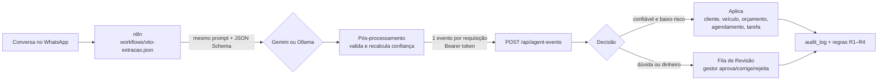

# Agentes de IA — como o "Vito" alimenta o sistema

O Vito é o atendente de WhatsApp da loja. Este documento explica como as conversas dele viram dados
no sistema do gestor **sem que a IA tenha acesso direto ao banco** e sem que um erro da IA estrague
o cadastro.

## Visão geral



Três camadas, cada uma desconfiando da anterior:

1. **IA (Gemini ou Ollama)** só devolve JSON no formato pedido (structured outputs); não conhece ids
   nem o banco.
2. **Pós-processamento** (`lib/agent/extraction.ts`, roda no n8n): valida evento a evento, monta o
   envelope por código (o telefone vem do metadado do WhatsApp, nunca do texto) e **rebaixa a
   confiança** com checagens objetivas — evidência que não está na conversa, valor de orçamento que
   ninguém citou, agendamento no passado.
3. **Endpoint** (`app/api/agent-events`): token, tamanho, contrato zod, idempotência e as regras de
   decisão, numa única transação. É a única porta de entrada dos agentes.

## O contrato (§8.1 e §8.2 do plano)

Envelope comum + `data` específico do `type` (união discriminada em `lib/agent/schema.ts`; os
tipos TypeScript e o JSON Schema pedido à IA saem do mesmo zod).

```json
{
  "schema_version": "1.0",
  "event_id": "conv-8812-3-quote.created",
  "type": "quote.created",
  "occurred_at": "2026-10-15T14:02:00-03:00",
  "source": { "channel": "whatsapp", "conversation_id": "conv-8812", "message_ids": ["m1", "m2"] },
  "agent": { "name": "vito-extrator", "model": "gemini-3.5-flash", "prompt_version": "extracao-v2" },
  "confidence": 0.92,
  "evidence": "Com montagem e balanceamento fica R$ 1.840,00.",
  "customer": { "phone": "(19) 90000-0021", "name": "Mariana" },
  "data": { "description": "4 pneus 205/55 R16 com montagem", "total": 1840, "quantity": 4 }
}
```

| `type` | O que faz no sistema | Risco |
|---|---|---|
| `customer.upserted` | preenche nome/e-mail/cidade **vazios** | baixo |
| `vehicle.identified` | cria/atualiza veículo pela placa | baixo |
| `interaction.logged` | registra o atendimento na linha do tempo | baixo |
| `quote.created` | cria orçamento (dispara R1, follow-up em 3 dias) | baixo |
| `task.suggested` | cria ação na tela Hoje | baixo |
| `appointment.requested` | cria agendamento (dispara R4, confirmar na véspera) | baixo |
| `quote.status_changed` | aprova/recusa orçamento | **alto: sempre revisão** |
| `service.completed` | registra serviço (dispara R2 e R3) | **alto: sempre revisão** |

### Respostas do endpoint

| HTTP | Corpo | Quando |
|---|---|---|
| 201 | `{"status":"applied","event_id":…,"customer_id":…,"applied":[…]}` | confiança ≥ `AGENT_AUTO_APPLY_THRESHOLD` (0,85), baixo risco, cliente único ou novo |
| 202 | `{"status":"queued_for_review","review_id":…,"reason":…}` | `baixa_confianca`, `alto_impacto`, `cliente_nao_encontrado`, `varios_clientes`, `conflito_edicao_humana` |
| 200 | `{"status":"duplicate","event_id":…}` | o mesmo `event_id` já chegou (reenvio do n8n não duplica nada) |
| 401 / 413 / 415 / 422 | `{"error":…}` | token, tamanho (64 KB), tipo de conteúdo, contrato |

### Regras que protegem o cadastro

- O agente **só preenche campos vazios**. Valor diferente num campo que o gestor editou vira
  `conflito_edicao_humana` na Revisão; nos demais casos é ignorado e registrado.
- Cliente novo só é criado (como **provisório**) por evento confiável e de baixo risco. Número
  desconhecido com mensagem vaga vai para a Revisão.
- Tudo que o agente grava fica no `audit_log` com o evento de origem: a ficha mostra "veio do Vito"
  com a evidência.

## Como isso ajuda o gestor

- **Menos digitação:** cliente, carro, orçamento e agendamento já aparecem na ficha depois da conversa.
- **Nada esquecido:** orçamento gera follow-up em 3 dias, agendamento gera "confirmar na véspera",
  reclamação gera ação de pós-venda para hoje — tudo na tela **Hoje**.
- **Controle onde importa:** aprovação de orçamento e serviço feito (dinheiro e histórico) passam
  sempre pelo gestor, com a evidência e a comparação "antes × proposto" na tela **Revisão**.

## Dois provedores, um seletor (D42)

| | Gemini (`gemini-3.5-flash`) | Ollama (`qwen2.5:7b`, local) |
|---|---|---|
| Qualidade nas conversas de teste | ver `docs/AVALIACAO_IA.md` | ver `docs/AVALIACAO_IA.md` |
| Dados | saem para o Google — **só fictícios** | ficam no computador da loja (LGPD) |
| Custo | plano gratuito, com limite e instabilidade | grátis; exige um PC com ~8 GB de RAM livres |
| Falhas | 429/503 → novas tentativas e modelos reserva (D43) | sem limite de uso; mais lento na CPU |

O provedor é escolhido no workflow do n8n (`provider` na conversa ou `VITO_PROVIDER`). Os dois usam
**o mesmo prompt, o mesmo JSON Schema e o mesmo pós-processamento**, então a comparação é justa.

## Como testar

- **Sem IA, na demo publicada:** tela **Simulador** — 6 conversas fictícias que chamam o endpoint
  real por HTTP (inclusive o reenvio, que mostra a idempotência).
- **Com IA:** `infra/n8n/README.md` (importar o workflow e enviar `exemplo-conversa.json`).
- **Medindo a IA:** `npx tsx --env-file=.env.local scripts/avaliar-extracao.ts --provedor ambos --salvar`.

## Limitações conhecidas

- A nota vem de 5 conversas fictícias: ela serve para comparar provedores e versões do prompt, não
  garante a qualidade com conversas reais. O próximo passo seria anonimizar conversas reais para o
  conjunto de teste.
- Na CPU, o Ollama leva de segundos a dezenas de segundos por conversa. Para o WhatsApp isso é
  aceitável, porque o webhook responde na hora e a extração roda depois.
- A conversa inteira vai num único pedido. Conversas muito longas precisariam ser divididas.
