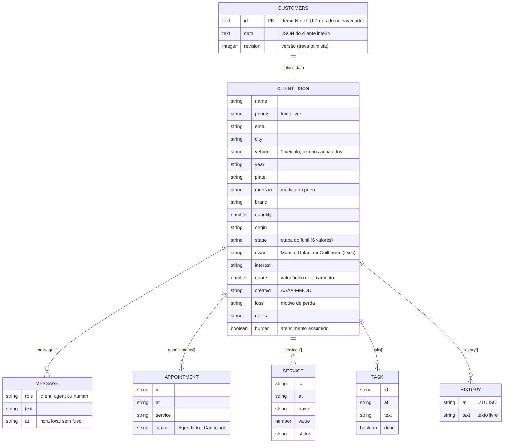
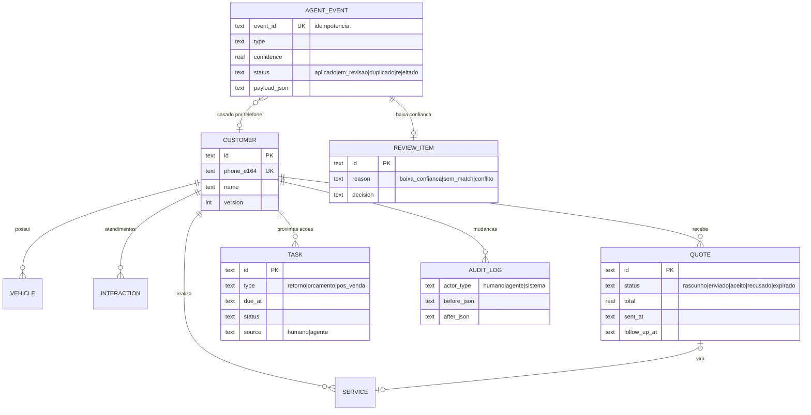

# Diagnóstico — sistema_atendimento_pneus

> Inspeção somente leitura em 13/10/2026 sobre o commit `1609d51` (`main` de `virtuvito/projetos`). Ambiente: Windows 11, Node 22.14.0, pnpm 11.25.0 (via corepack), Chrome do sistema para Playwright 1.64 / axe-core 4.13 / Lighthouse 13.5. Screenshots: `docs/diagnostico-screenshots/` (34 arquivos). "(código)" = verificado só por leitura; o resto foi executado.

## 1. Resumo executivo

- **Estado geral:** protótipo visual bem acabado, gerado pela plataforma *Sites* do ChatGPT (agente Codex) sobre **vinext (beta) + Cloudflare Workers + D1**. Instala, compila e roda localmente (com um passo manual de migração), mas toda a interface está num único arquivo "minificado" de 29 KB, sem testes, sem login, e cada cliente é gravado como um único JSON.
- **3 maiores problemas:** (1) **API aberta** — qualquer pessoa lê e sobrescreve clientes (`GET/POST /api/crm` sem autenticação; confirmado na demo pública), inviável com dados reais (LGPD); (2) **modelo de dados em "blob" JSON** sem orçamento, veículo, tarefa tipada, evento de agente nem auditoria confiável, e cada alteração regrava o documento inteiro → conflitos 409 assim que um agente escrever; (3) **acessibilidade e legibilidade abaixo de AA** (597 falhas de contraste no axe, selects sem nome, busca sem foco visível; Lighthouse acessibilidade 89–95) e **bugs de data** (histórico mostra hora UTC; demo pública "congelada" em 24/09).
- **3 maiores oportunidades:** (1) trava otimista por `revision`, validação zod e estados de carregamento/erro já existem e servem de base para o endpoint de eventos; (2) "Visão geral" + "Próximos contatos" já são o embrião do painel "Hoje"; (3) Workers + D1 cabem no plano gratuito sem servidor "dormindo", e o Drizzle já está configurado para migrar para tabelas normalizadas.

## 2. Stack e estrutura

| Camada | Tecnologia (versão instalada) | Observação |
|---|---|---|
| Linguagem | TypeScript 5.9.3 (`strict`), CSS | scripts de build em Node e Bash |
| Framework | **vinext 1.0.0-beta.5** sobre **Vite 8.0.13** | reimplementação da API do Next.js (App Router: `app/`, `route.ts`, `layout.tsx`) feita pela Cloudflare para rodar em Workers. O pacote `next` 16.3.4 está instalado só para tipos/compatibilidade; quem executa é o vinext |
| UI | React 19.2.6, Tailwind CSS 4.2.1, shadcn/ui (Radix UI 1.6.7), lucide-react 1.31.0, sonner 2.0.8 | 61 componentes shadcn vendorizados, 11 usados |
| Validação | zod 3.25.76 | `lib/validation.ts` |
| Runtime | Cloudflare Workers (`@cloudflare/vite-plugin` 1.37.1, wrangler 4.92.0, workerd) | flag `nodejs_compat` |
| Banco | Cloudflare D1 (SQLite gerenciado) via *binding* `DB` | Drizzle ORM 0.45.2 / drizzle-kit 0.31.10 só para schema e migração; as consultas são SQL cru |
| Qualidade | ESLint 9.39.4 + eslint-config-next 16.3.4 | sem Prettier, sem testes, sem CI |
| Pacotes | **pnpm 11.25.0** (`package.json:68`), Node **>=22.13.0** (`package.json:6`) | `pnpm-workspace.yaml` impõe idade mínima de 7 dias para pacotes e builds explícitos |

*Binding* D1, em uma frase para entrevista: no Workers o banco não é acessado por URL e senha; a plataforma injeta um objeto `env.DB` no código (`lib/database.ts:2`).

**Árvore (3 níveis, sem `node_modules`/`dist`/caches):**
```
sistema_atendimento_pneus/
├── app/
│   ├── api/crm/route.ts      # ÚNICO endpoint: GET e POST /api/crm (2 linhas longas)
│   ├── chatgpt-auth.ts       # helpers "Sign in with ChatGPT" do template — não usado
│   ├── globals.css           # tema + todo o CSS das telas (145 linhas, 23 KB)
│   ├── layout.tsx            # <html lang="pt-BR">, título, meta codex-preview
│   └── page.tsx              # TODA a UI: 7 telas + 2 modais, 1 componente client (29 KB)
├── build/sites-vite-plugin.ts # plugin da OpenAI (login simulado local, copia migrations no build)
├── components/ui/            # 61 componentes shadcn vendorizados (11 usados)
├── db/                       # schema.ts (tabela customers) + index.ts (getDb, não usado)
├── drizzle/                  # 0000_slim_scarlet_spider.sql + meta/
├── examples/d1/              # exemplo "notes" do template — não usado
├── hooks/use-mobile.ts       # breakpoint de 768px usado pelo menu lateral
├── lib/                      # crm.ts (tipo, seed, datas), validation.ts (zod), database.ts, utils.ts
├── public/                   # favicon.svg + 3 SVGs do template
├── scripts/                  # instaladores/execução da plataforma Sites (Node + Bash/Linux)
├── vendor/                   # CSS do shadcn para Tailwind 4
├── .openai/hosting.json      # bindings D1/R2 e project_id da hospedagem ChatGPT Sites
├── vite.config.ts            # vinext + plugin Cloudflare + bindings locais (id de banco placeholder)
├── next.config.ts            # vazio
├── PROJETO.md                # nota da Virtù (pt-BR); README.md é o do template (inglês)
└── package.json · pnpm-lock.yaml · pnpm-workspace.yaml · tsconfig.json · eslint.config.mjs
```

**Como foi gerado (evidências):**
- Nome `site-creator-vinext-starter` (`package.json:2`). O README é o do *starter* ("The Sites initializer copies the shared starter", `README.md:14`).
- `.openai/hosting.json` (bindings + `project_id: appgprj_…`) e `build/sites-vite-plugin.ts:1` ("Vendored from @openai/sites-vite-plugin 0.2.0").
- `app/layout.tsx:8` (meta `codex-preview`), `vite.config.ts:12-13` (`CODEX_SANDBOX`), `.gitignore:43-44` (`/.agents/`, `/.codex/`) e a demo em `*.chatgpt.site`.
- Migração gerada em 24/09/2026 (`drizzle/meta/_journal.json:8`), mesma data em que os dados da demo pública foram criados.
- `page.tsx` e `globals.css` em linhas de até 4.295 caracteres, um padrão típico de código gerado por agente.
- **Conclusão:** gerado pelo criador de sites do ChatGPT (agente Codex) a partir de um starter da OpenAI e depois copiado como *snapshot* para o monorepo da Virtù (`PROJETO.md:7`).

**Histórico do git:**
- **Projeto:** 1 commit, `1609d51` (09/10/2026 18:49 -03:00, `virtuvito <contato@grupovirtu.com>`, "Adiciona sistema de atendimento para pneus como projeto independente"), com os 112 arquivos de uma vez. O commit de origem citado em `PROJETO.md:7` (`3a19ff44…`) não existe neste repositório, então o histórico real de desenvolvimento não está disponível.
- **Monorepo:** 44 commits (11/09 a 09/10/2026), 7 projetos. Autores `virtuvito` (34) e `Grupo Virtu` (10), com o mesmo e-mail. Mensagens em português no presente ("Adiciona…", "Melhora…", "Refina…"), algumas em inglês. Há várias mensagens idênticas a segundos de distância (ex.: 7× "Refina identidade visual…" em 25/09), o que sugere commits automatizados por arquivo. As outras branches remotas não tocam este projeto.

## 3. Como rodar (com resultado real da execução)

Testado no Windows (Git Bash/PowerShell), dentro de `sistema_atendimento_pneus/`:

| # | Comando | Resultado real |
|---|---|---|
| 1 | `corepack pnpm install --frozen-lockfile` | ✔ 627 pacotes em ~70 s. Avisos: ~15× `[WARN] Request took 10075ms: https://registry.npmjs.org/...` (lentidão ao verificar a "supply-chain policy") e "Update available! 11.25.0 → 12.11.2". Não precisa instalar pnpm global: o corepack (vem com o Node 22) baixa a versão fixada. O store fica dentro do projeto (`.sites-runtime/pnpm-store`) |
| 2 | `corepack pnpm dev` **antes** da migração | ⚠ página abre (200), mas `GET /api/crm` → **503** e log `D1_ERROR: no such table: customers: SQLITE_ERROR`; a tela mostra "Não foi possível abrir a central". A migração não é aplicada sozinha |
| 3 | `corepack pnpm build` | ✔ 19 s. Avisos: `[PLUGIN_TIMINGS]` e "Some routes could not be classified" (rota `/`) |
| 4 | `node --import ./scripts/sites-env.mjs ./node_modules/wrangler/bin/wrangler.js d1 execute DB --local --config dist/server/wrangler.json --persist-to .wrangler/state --file drizzle/0000_slim_scarlet_spider.sql` | ✔ "1 command executed successfully" (precisa do passo 3 antes, para existir `dist/server/wrangler.json`; `README.md:103-107`) |
| 5 | `corepack pnpm dev` | ✔ `http://localhost:5173`, API 200. **Escuta só em `[::1]`**: `127.0.0.1:5173` não conecta. Avisos: `ExperimentalWarning: glob is an experimental feature` (Node 22.14) e "Sites local sign-in: seedy@sites.test" |
| 6 | `corepack pnpm start` | ✔ preview do Worker de produção em `http://127.0.0.1:8787` (Wrangler local; mesmo banco `.wrangler/state` do dev). Aviso: "update available 4.150.0" |
| — | `corepack pnpm lint` | ✘ sai com código 1 (16 problemas, ver §7) |
| — | `npm run install:ci` | não executado: exige Linux (`flock`, GNU `timeout`; `scripts/install-pnpm.sh:19`) — falharia no Windows (código) |

- **Variáveis de ambiente:** o app só usa o *binding* `env.DB` (`lib/database.ts:2`; `BUCKET` é declarado em `cloudflare-env.d.ts:4`, mas não é usado). As demais são de ferramentas: `CODEX_SANDBOX`, `CLOUDFLARE_CF_FETCH_ENABLED`, `WRANGLER_SEND_METRICS`, `WRANGLER_WRITE_LOGS`, `WRANGLER_LOG_PATH`, `WRANGLER_REGISTRY_PATH`, `MINIFLARE_REGISTRY_PATH`, `SHARP_IGNORE_GLOBAL_LIBVIPS`, `SITES_MANAGED_LINUX_CONTAINER` e ~20 `SITES_*` dos instaladores (ex.: `SITES_RUNTIME_ROOT`, `SITES_PNPM_SHARED_STORE`, `SITES_BUILD_TIMEOUT`). **Não existe `.env.example`** (nem `.env`); o `.gitignore` ignora `.env*`.
- **Scripts (`package.json:8-15`):**
  - `install:ci`: instalador da plataforma Sites (`bash scripts/install-pnpm.sh`, só Linux).
  - `dev`: `vinext dev --port 5173` via `scripts/run-framework.mjs`.
  - `build`: `vinext build`; gera `dist/client`, `dist/server/wrangler.json` e copia `drizzle/` para `dist/.openai`.
  - `start`: `wrangler dev` do build com D1 local.
  - `lint`: ESLint.
  - `db:generate`: `drizzle-kit generate` (SQL a partir de `db/schema.ts`).
  - Não há `test`, `format`, `typecheck` nem script para aplicar migrações.
- **Bundle de produção:**
  - **Cliente:** JS 609 KB (183 KB gzip) em 3 chunks principais (página 223 KB, index 193 KB, framework 190 KB) e CSS 169 KB (26 KB gzip). O CSS é inflado pelos 50 componentes não usados que o Tailwind também varre.
  - **Worker:** 772 KiB.
- **Pastas geradas e ignoradas pelo git** (não foram apagadas): `node_modules/`, `.sites-runtime/`, `dist/`, `.wrangler/` (banco local limpo, só com a migração), `.vinext/`, `.next/`, `next-env.d.ts`.
- O `tsc` foi rodado com `--incremental false` porque `tsconfig.json:19` geraria `tsconfig.tsbuildinfo`, que não está no `.gitignore`.

## 4. Arquitetura e modelo de dados

**Front-end:**
- Uma única rota `/` (`app/page.tsx:1`, `'use client'`). As "telas" são um estado `page` (`page.tsx:17`), não rotas: F5 e o "voltar" do navegador perdem a tela, e não dá para linkar um cliente.
- Telas: Visão geral, Clientes, Funil de vendas, Atendimentos, Agenda, Serviços e Próximos contatos (`page.tsx:30-37`), mais 2 modais: Ficha do cliente (`:39`) e formulário de Agenda/Serviço/Contato/Remarcar (`:40`).
- Estado: 17 `useState` num só componente, sem biblioteca de estado.
- Dados: um `fetch('/api/crm')` no início carrega todos os clientes (`:18`). Cada alteração envia o **cliente inteiro** por POST (`:19`), e as listas derivadas são recalculadas a cada render (`:22-24`).

**Back-end:** existe, dentro do próprio app (route handlers do vinext rodando no Worker), sem camadas: o handler faz a validação e o SQL direto.

| Método | Rota | O que faz | Autenticação | Validação |
|---|---|---|---|---|
| GET | `/api/crm` | executa 16× `INSERT OR IGNORE` dos clientes de exemplo e devolve **todos** os clientes com todos os dados (`route.ts:4`) | nenhuma | — |
| POST | `/api/crm` | cria (`revision 0`) ou substitui o cliente inteiro se a `revision` bater; senão 409 (`route.ts:5`) | nenhuma; recusa `Origin` diferente (403), mas aceita requisição sem `Origin` | zod (`lib/validation.ts:4`), corpo ≤ 200 KB |

- **Trava otimista** (para defender em entrevista): cada registro tem uma versão. O `UPDATE … WHERE id=? AND revision=?` só altera se ninguém gravou antes; se gravou, devolve 409 em vez de sobrescrever em silêncio. Testado: funciona.

**Persistência:**
- Banco **real** (D1/SQLite), sem mock e sem `localStorage`. Uma tabela: `customers(id TEXT PK, data TEXT, revision INTEGER DEFAULT 1)` (`db/schema.ts:2`, `drizzle/0000_slim_scarlet_spider.sql:1-5`).
- Tudo do cliente fica no JSON da coluna `data`. Não há índices nem colunas consultáveis (telefone, etapa, datas).
- **Dados de exemplo:** criados pelo GET com datas relativas ao dia do 1º acesso e depois congelados (`lib/crm.ts:7`).
- **Produção:** o build copia `drizzle/` e a plataforma aplica as migrações (`build/sites-vite-plugin.ts:173-189`, `README.md:109`).

**Modelo atual (o JSON é um tipo TS em `lib/crm.ts:4`):**


**Comparação com o que o desafio exige:**

| Entidade | Hoje | O que precisa mudar |
|---|---|---|
| Cliente | ✔ no JSON | tabela própria; telefone normalizado (E.164: `+5519…`) com índice único; `updated_at/updated_by` |
| Veículo | ⚠ campos achatados, 1 por cliente | tabela `vehicles` (1:N) com placa e medida |
| Atendimento | ⚠ `messages[]` fictícias + flag `human` | interação com canal, data, resumo, origem (agente/humano) |
| Serviço | ⚠ `services[]` sem vínculo | ligar a veículo e orçamento |
| Orçamento com status | ✘ só `quote` (número) + etapa do funil | tabela com status (rascunho/enviado/aceito/recusado/expirado), validade, data de follow-up |
| Próxima ação/tarefa | ⚠ `tasks[]` (data, texto, feito) | tipo (retorno comercial/orçamento/pós-venda), responsável, origem, vínculo |
| Evento de agente | ✘ | tabela *append-only* com `event_id` único, payload, confiança, status |
| Fila de revisão | ✘ | itens pendentes + tela de decisão |
| Auditoria | ⚠ `history[]` em texto livre **enviado pelo navegador** (pode ser reescrito) | `audit_log` gravado só pelo servidor (quem, quando, origem, antes/depois) |

**Modelo-alvo sugerido (mínimo):**


## 5. Inventário de funcionalidades

| Tela / funcionalidade | Funciona? | Problemas | Utilidade para o dono |
|---|---|---|---|
| Visão geral (métricas, gráfico, funil-resumo, agenda de hoje, "Precisam da sua atenção") | Sim | B9, B10; no celular as ações ficam depois de ~1.700 px de rolagem; mostra só 3 retornos | Média: informa, mas não organiza o dia |
| Clientes (tabela, busca, filtro por etapa) | Sim | B4, B5; no celular Etapa/Orçamento ficam escondidos à direita; sem paginação | Alta |
| Exportar CSV | Sim | B6; exporta telefone/e-mail sem controle de acesso | Baixa |
| Ficha do cliente (Cadastro / Histórico / Serviços e retornos) | Sim | B1, B7, B8; 1 veículo; histórico em texto livre; erro de validação genérico ("Confira os campos…") | Alta (base da linha do tempo) |
| Novo cliente | Sim | sem checagem de telefone duplicado; id gerado no navegador (`lib/crm.ts:1`) | Média |
| Funil de vendas (Kanban) | Parcial | arrastar só por HTML5 drag-and-drop (sem teclado/toque); com eventos HTML5 funcionou, mas com mouse simulado o *drop* não disparou (mouse real não verificado); rolagem lateral; "Perdido" exige motivo (bom) | Média |
| Atendimentos (chat) | **Só simulação** | conversas fictícias fixas; "Assumir atendimento" só alterna uma flag; nada vai ao WhatsApp; lista com 210 px no celular | Baixa hoje; útil se virar "resumo do agente" |
| Agenda (dia, status, remarcar) | Sim | B2; formulário pré-seleciona o 1º cliente da lista (`page.tsx:28`); status sem rótulo acessível | Média |
| Serviços (tabela, status) | Sim | "Registrar serviço" grava sempre "Concluído" e muda a etapa do cliente (`page.tsx:40`) | Média |
| Próximos contatos (filtros, concluir, novo) | Sim | sem tipo nem responsável próprio; checkbox de 22 px com borda 1,3:1 | Alta (embrião do "Hoje") |
| Perfil "Guilherme", "Autocenter Campinas", selo "Demonstração" | Placeholder | fixos no código (`page.tsx:28`); sem login | — |
| Carregando / erro / vazio | Sim | erro testado: mensagem + "Tentar novamente" recupera | — |
| Ferramenta `list_crm_customers` (WebMCP) | Não verificado | usa API experimental `document.modelContext` (`page.tsx:21`), ausente no Chrome comum | — |

**Bugs com passos para reproduzir:**
- **B1 – Hora errada no histórico:** Clientes → abrir ficha → alterar Observações → Salvar → reabrir → Histórico. Salvei às **18:39** (Brasília) e apareceu **21:39**. Causa: grava `toISOString()` (UTC) (`page.tsx:26,39,40`), e `time()` só recorta a string (`page.tsx:13`). As mensagens usam hora local sem fuso, então há 2 formatos misturados.
- **B2 – "Remarcar" trocando o cliente:** Agenda → Remarcar (Carolina) → trocar Cliente para Ricardo → data → Salvar. Ricardo ganha "Agendamento remarcado…" sem ter agendamento; o da Carolina não muda (`page.tsx:40`).
- **B3 – Menu do celular não fecha:** em 375 px → ícone do menu → "Clientes". A gaveta continua aberta cobrindo a tela (8/8 vezes); `go()` (`page.tsx:20`) não fecha o menu.
- **B4 – Avatar quebrado** na tabela de Clientes (desktop e celular): `.person>span{display:block}` anula `.avatar{display:inline-flex}` (`globals.css:139`).
- **B5 – Busca sensível a acento e formato:** "andre" → 0 e "André" → 1; "19 00000" → 0 para "(19) 00000-…" (`page.tsx:22`).
- **B6 – CSV altera dados:** "+55 19 98888-7777" sai como "'55 19 98888-7777" e "=1+1 Onix" como "'1+1 Onix". O código troca o 1º caractere em vez de prefixar (`page.tsx:25`).
- **B7 – Conflito sem saída:** ficha aberta + outra gravação do mesmo cliente (ex.: agente) → Salvar dá 409 "Recarregue antes de salvar", sem botão de recarregar/mesclar; recarregar a página perde a edição.
- **B8 – Data inválida aceita:** a API grava `created: "2026-99-99Tqualquer coisa"` (regex fraca em `lib/validation.ts:3`), e a ficha mostra o campo vazio.
- **B9 – Demo congelada:** os dados de exemplo nascem no 1º GET e não mudam (`route.ts:4`, `lib/crm.ts:7`). Na demo pública (criada em 24/09) a agenda de hoje está vazia, as 8 tarefas aparecem atrasadas e agendamentos passados continuam "Confirmado".
- **B10 – Gráfico satura:** 23 px por cliente com teto de 135 px (`page.tsx:30`, `.bar{max-height}` em `globals.css:139`) → todas as barras iguais a partir de ~6 contatos/semana; "Todo o período" mostra só 5 semanas.

## 6. Prontidão para agentes de IA

**Pontos de entrada hoje:**
- `POST /api/crm` (`route.ts:5`) é o único. Ele **aceita escrita de qualquer cliente HTTP sem `Origin`** (testado: criei `externo-1` via curl → 200), mas não serve como integração: o agente teria de ler o cliente, montar o documento inteiro com a `revision` atual e regravar. Não há idempotência, registro de origem nem confiança.
- A ferramenta WebMCP (`page.tsx:21`) é só leitura e só funciona dentro do navegador.
- Não há webhook, importação nem fila.

**O que precisa existir para receber o n8n com segurança** (endpoint separado, ex.: `POST /api/agent-events`):
1. **Autenticação:** `Authorization: Bearer <token>`, com o token guardado como *secret* do Worker (`wrangler secret put`) e na credencial do n8n, comparado em tempo constante. Opcional: assinatura HMAC do corpo + timestamp, para evitar *replay*.
2. **Schema:** zod com união discriminada por `type` (ex.: `cliente.identificado`, `orcamento.enviado`, `orcamento.status`, `servico.realizado`, `acao.sugerida`, `atendimento.resumo`), mais `schemaVersion` e limites de tamanho. Erro 422 com a lista de campos, para o n8n registrar.
3. **Idempotência:** o mesmo evento enviado 2× produz 1 efeito. O n8n gera `event_id` (ex.: hash de conversa + mensagem + tipo); a tabela tem `UNIQUE(event_id)` e `INSERT … ON CONFLICT DO NOTHING`; o reenvio responde `duplicate`. Motivo: o n8n reexecuta em caso de timeout.
4. **Matching por telefone:** normalizar para E.164 (ex.: `libphonenumber-js`) com índice único. 1 match → aplica; 0 → lead "não confirmado" ou fila; >1 → fila. Hoje o telefone é texto livre.
5. **Origem:** `source=whatsapp`, `conversation_id`, `message_ids`, trecho mínimo de evidência, `agent`, `model`, `prompt_version`, `confidence`, `received_at`. Cada registro criado guarda o `agent_event_id`.
6. **Confiança 0–1:** acima do limiar (ex.: 0,85), aplicar automaticamente só criações de baixo risco (tarefa, nota, orçamento novo); abaixo, ou quando mexer em campo já editado por humano, enviar para `review_items`.
7. **Conflitos:** aplicar mudanças por entidade (inserir orçamento, inserir tarefa) em vez de regravar o cliente. Política "humano vence"; tudo em `audit_log`.
8. **Resposta ao n8n:** `{status: applied | queued_for_review | duplicate | rejected, ids, errors}`.

**Riscos de concorrência/inconsistência (hoje):**
- Gravar o documento inteiro (`page.tsx:19` + `route.ts:5`): a trava impede a perda silenciosa, mas com agentes escrevendo o gestor receberá 409 com frequência (B7).
- `history` e `messages` vêm do navegador: um cliente HTTP pode apagar ou reescrever o histórico.
- IDs gerados no navegador e sem unicidade por telefone → duplicatas quando agente e gestor cadastram a mesma pessoa.
- Datas em 2 formatos (local sem fuso × UTC) → "vencido/hoje" errado se o agente mandar outro formato. Padronizar: UTC no banco, exibição em `America/Sao_Paulo`.
- O GET grava (seed) a cada leitura (`route.ts:4`).

## 7. Qualidade de código

- **TypeScript:**
  - `strict: true` (`tsconfig.json:11`); `tsc --noEmit` passou **sem erros**.
  - **11 `any` explícitos** (`page.tsx:18,19,21,35,40,41`; `route.ts:4`) e `as any` no fluxo "Remarcar" (`page.tsx:35,40`).
  - Tipos "compartilhados" só por estarem no mesmo repo: o tipo `Client` (`lib/crm.ts:4`) e o schema zod (`lib/validation.ts:4`) são escritos duas vezes e podem divergir. Use `z.infer`. Etapa, status e origem são `string` soltas.
- **Lint:** `pnpm lint` → **16 problemas (13 erros, 3 avisos)**:
  - 11 `no-explicit-any`;
  - 3 imports não usados (`stages` em `route.ts:3`; `TrendingUp` e `Menu` em `page.tsx:3`);
  - 1 `prefer-const` (`page.tsx:40`);
  - 1 `react-hooks/set-state-in-effect` (`page.tsx:18`).
  - Sem Prettier nem script de formatação.
- **Legibilidade:** `page.tsx` tem 29 KB em 43 linhas (até 4.295 caracteres por linha) e `globals.css` 23 KB em 145 linhas: inviável revisar diffs. Um componente `App` reúne 17 `useState`, 7 telas, 2 modais, regras de negócio (métricas, períodos, filtros) e HTTP misturados no JSX.
- **Duplicação:** filtro "pendentes até hoje" repetido (`page.tsx:28`, `:30` 2×); "agenda de hoje" calculada 3× (`:30`); filtro de "Próximos contatos" duplicado (`:37`).
- **Código morto:**
  - 50 de 61 componentes de UI.
  - Dependências sem uso no código executado: `@base-ui/react`, `react-hook-form`, `@hookform/resolvers`, `recharts`, `date-fns`, `cmdk`, `vaul`, `embla-carousel-react`, `input-otp`, `next-themes`, `react-day-picker`, `react-resizable-panels`, `@shadcn/react` (o `drizzle-orm` só é usado pelo schema).
  - `db/index.ts` (getDb), `examples/d1/`, `app/chatgpt-auth.ts`, `next.config.ts` vazio.
  - `scripts/install-ci.*` usa um `package-lock.json` que não existe (`scripts/install-ci.sh:66`), e o README diz que `install:ci` roda `npm ci` (`README.md:20`), o que não é mais verdade.
  - Não há TODO/FIXME.
- **Estados de tela:** carregando (`page.tsx:29`), erro com "Tentar novamente" (testado) e vazio em todas as listas: bom. Erros de API viram toast genérico, sem apontar o campo; o 409 não oferece ação.
- **Lógica de datas espalhada e inconsistente:** `day()` usa `America/Sao_Paulo` (`lib/crm.ts:5`), mas `time()` recorta a string (`page.tsx:13`) → B1.

## 8. Testes

- **Não existem:** nenhum arquivo de teste, runner (Vitest/Jest/Playwright), script `test` ou CI. A cobertura não é mensurável (0%).
- Os testes que rodei (curl, Playwright, axe, Lighthouse) foram exploratórios e ficaram fora do repositório.
- **Mais crítico a testar** (em ordem):
  1. Endpoint de eventos: token, schema, mesmo `event_id` 2×, matching por telefone, roteamento por confiança, conflito com edição humana.
  2. Regras do "Hoje" (vencido/hoje/orçamento parado/pós-venda), com fuso `America/Sao_Paulo` e virada do dia.
  3. Trava otimista (409).
  4. Validação zod (datas, valores, motivo de perda).
  5. CSV.
  6. E2E de fumaça (Hoje → ficha → concluir ação) com axe.
- **Ferramentas sugeridas:** Vitest (unidade e integração; para D1 local existe `@cloudflare/vitest-pool-workers`, mas a compatibilidade com vinext não foi verificada) + Playwright com `@axe-core/playwright`.

## 9. Segurança e LGPD

- **Segredos:** nenhum no código nem no histórico (1 commit; busca por chaves, tokens, senhas, `.env`, `.pem`). `.openai/hosting.json:4` tem o `project_id` da hospedagem, que é um identificador, não uma credencial.
- **Autenticação/autorização: inexistente.**
  - `GET /api/crm` devolve todos os clientes com telefone, e-mail e placa; `POST` cria ou sobrescreve qualquer cliente. A demo pública respondeu `GET /api/crm` com 200, sem login.
  - Os helpers "Sign in with ChatGPT" (`app/chatgpt-auth.ts`) não são usados, dependem da hospedagem da OpenAI e só provam identidade, não permissão (`README.md:97`).
  - Na sua versão: proteger no mínimo a escrita e o endpoint do agente (ex.: senha do gestor com cookie `httpOnly`, ou Cloudflare Access — confirmar plano gratuito).
- **Validação de entrada:** zod com limites de tamanho e corpo ≤ 200 KB (testado: 413). Fracos: datas (aceita lixo), e-mail não validado como e-mail, telefone livre e `id` escolhido pelo cliente.
- **Injeção SQL:** protegido, com consultas preparadas e `bind` (`route.ts:4-5`).
- **XSS:** o React escapa texto; o payload `` gravado via API apareceu como texto (testado). Não há `dangerouslySetInnerHTML` no código usado.
- **CSRF/CORS:** não há cabeçalhos CORS, então outro site não lê as respostas. O POST recusa `Origin` diferente (403, testado), mas aceita requisições sem `Origin` e com qualquer `Content-Type`.
- **Cabeçalhos de segurança:** nenhum (CSP, `X-Content-Type-Options`, `frame-ancestors`/`X-Frame-Options`, `Referrer-Policy`), nem no local nem na demo. Também não há *rate limiting* no app.
- **Dados pessoais:**
  - Telefone, e-mail e placa aparecem na tela, na API e no CSV. As conversas ficam inteiras em `messages[]`.
  - Os logs (`console.error(e)`, `route.ts:4-5`) não gravam o payload.
  - **Não existe exclusão de cliente** (sem DELETE), então não dá para atender pedido de eliminação (LGPD art. 18).
  - Com dados reais seria preciso: base legal, aviso sobre uso de IA, minimização (guardar a extração e um trecho mínimo, não a conversa toda), retenção definida e controle e registro de acesso. E **não enviar dados reais a APIs de IA gratuitas que usam o conteúdo para melhorar produtos** (ver §12).
- **`pnpm audit` (13/10/2026): 62 vulnerabilidades — 1 crítica, 30 altas, 23 moderadas, 8 baixas.**
  - A maioria é em ferramentas de desenvolvimento: eslint (`brace-expansion`, `js-yaml`), wrangler/miniflare (`undici`, `ws`), servidor dev do Vite, `drizzle-kit`/`esbuild`.
  - Relevantes ao runtime:
    - `next` 16.3.4: crítica, RCE em `next/og` ImageResponse, que o app não usa; também SSRF e envenenamento de cache. Corrigido em ≥16.3.8.
    - `react-server-dom-webpack` 19.2.6: DoS em Server Functions, que o app não define. Corrigido em ≥19.2.8.
    - dependências do vinext: `image-size`, `fflate`.
  - **Impacto real não verificado.** Atualizar `next`, `react-server-dom-webpack`, `vite` (≥8.0.16), `wrangler` e `vinext`, e rodar de novo. O `.npmrc:1` desliga o audit automático.

## 10. Acessibilidade

**Notas (Lighthouse 13.5):**

| Execução | Acessibilidade | Desempenho | Boas práticas | SEO |
|---|---|---|---|---|
| Local (preview de produção), mobile — Visão geral | 89 | 97 | 100 | 100 |
| Local, desktop — Visão geral | 90 | 100 | 100 | 100 |
| Demo pública, mobile — Visão geral | 89 | 71¹ | 81² | 100 |
| Demo pública, desktop — Visão geral | 90 | 100 | 100 | 100 |
| *Snapshots* desktop locais: Clientes / Funil / Atendimentos / Agenda / Serviços / Próximos contatos | 91 / 93 / 95 / 90 / 90 / 90 | n/a | 100 | 100 |

¹ HTML levou 2,3 s na 1ª medição (provável *cold start*); depois o TTFB ficou em 0,15–0,52 s. ² Os avisos vêm do script anti-bot da Cloudflare (`/cdn-cgi/challenge-platform`), injetado pela hospedagem, não do app.

**axe-core 4.13** (WCAG 2.0/2.1/2.2 A+AA + boas práticas), 18 varreduras (7 telas + ficha + formulário, em 375 e 1440 px): `color-contrast` 597 nós, `region` 35, `button-name` 16, `heading-order` 2, `scrollable-region-focusable` 2, `empty-table-header` 2. Ferramentas automáticas pegam só parte dos problemas: nota 90 não significa "AA".

**Problemas por severidade:**

*Alto — reprovam AA:*
1. **Contraste de texto (1.4.3):** 50 combinações abaixo de 4,5:1.
   - `small` #808679 sobre branco: 3,74:1 (`globals.css:139`).
   - `.lead-origin` #93a084: 2,76:1.
   - `.kanban-value` #8e9983 sobre #eef1eb: 2,61:1.
   - Etiquetas de etapa `.b1`–`.b5`: 2,9–3,3:1.
   - `.overdue`: 3,32:1.
   - Rótulos de campo: 4,2:1.
   - Placeholder da busca: 3,1:1.
2. **Selects sem nome acessível (4.1.2; axe "crítico"):** período (`page.tsx:28`), filtro de etapa (`:31`), status na Agenda (`:35`) e em Serviços (`:36`), filtro de tarefas (`:37`). O leitor anuncia só "caixa de combinação". Corrigir com `aria-label` no `SelectTrigger` do `Pick` (`page.tsx:14`).
3. **Busca sem foco visível (2.4.7):** `.search input{outline:none}` anula o foco global (`globals.css:139`). Foi o único elemento sem indicador na varredura com Tab.
4. **Contraste de componentes (1.4.11):** borda do checkbox de tarefa #dce2d3 com 1,32:1 (o checkbox vazio quase some) e bordas de campos ~1,3:1 (`globals.css:139`).
5. **Região rolável das mensagens inacessível por teclado (2.1.1)** (`page.tsx:34`).

*Médio:*
6. **Rótulos em inglês numa página pt-BR (3.1.2):** "Toggle Sidebar" (`components/ui/sidebar.tsx:277`), "Sidebar"/"Displays the mobile sidebar." (`sidebar.tsx:199-200`), "Close" (`components/ui/dialog.tsx:76`, `components/ui/sheet.tsx:80`).
7. **Alvos de toque pequenos:** passam no 2.5.8 só pela exceção de espaçamento e ficam muito abaixo dos 44 px recomendados para celular.
   - Checkbox 22×22 (`.check-btn`, `globals.css:139`).
   - Botão do menu 28×28 (`sidebar.tsx:269`).
   - Fechar modal 16×16 (`dialog.tsx:73`).
   - "Ver agenda" 80×17.
   - Campo de busca com 20 px de altura útil.
8. **Estrutura:** menu lateral fora de *landmark* (use `<nav aria-label>`); o Funil pula de h1 para h3 (`page.tsx:33`); os cards do funil são `<button>` com h3/p/div dentro (HTML inválido e nome acessível enorme).
9. **Menu do celular não fecha (B3):** o foco fica na gaveta depois de escolher a tela.
10. **Contorno de foco fraco:** #83b834 tem 2,37:1 sobre branco (`globals.css:139`). É visível, mas abaixo de 3:1.

*Baixo:*
11. Cabeçalho vazio na última coluna da tabela (`page.tsx:32`).
12. Buscas rotuladas só por placeholder (`page.tsx:31,34`).
13. ~2/3 dos textos têm ≤ 12 px e vários 10 px (`globals.css:139-145`). Não reprova WCAG, mas dificulta a leitura no celular.

*Positivo:*
- `lang="pt-BR"` (`app/layout.tsx:22`), `<title>` e viewport sem bloquear zoom.
- Foco preso e Esc nos modais (Radix).
- Todos os botões têm foco visível, exceto a busca.
- Sem rolagem horizontal da página em 375 px.
- Botões de ícone com `aria-label`.

*Não verificado:* leitores de tela (NVDA/TalkBack), zoom 200%/320 px, aparelho real.

## 11. Responsividade e UX

**Breakpoints:** ≥1500, ≤1200 e ≤767 px (`globals.css:142-144`). O menu vira gaveta abaixo de 768 px (`hooks/use-mobile.ts:3`).

- **~375 px** (`mobile-375-*.png`):
  - Funciona bem: página sem rolagem lateral, métricas em 2×2, formulários em 1 coluna, modais com rolagem.
  - Tabela de Clientes: **989 px num espaço de 341 px**, com Etapa/Orçamento/Responsável escondidos e sem indicação.
  - Kanban com 1.395 px (1,5 coluna visível; arrastar é impraticável).
  - Lista de conversas presa em 210 px (~2 visíveis; `globals.css:144`).
  - Navegação atrás de um ícone de 28 px sem rótulo, que não fecha após a escolha.
- **~768 px** (`tablet-768-*.png`): o menu fixo de 256 px continua, então o conteúdo fica com ~510 px e as tabelas rolam (460 de 989 px).
- **Desktop 1440** (`desktop-1440-*.png`): bom uso do espaço; o Kanban ainda rola (1.395 > 1.116 px).

**Problemas para um dono não técnico, no celular, entre um atendimento e outro:**
- A tela inicial responde "como está a loja" (métricas), não "**o que fazer agora**". A lista de ações mostra 3 itens e fica no fim da página.
- Muitos toques para o básico: abrir o menu → escolher → fechar o menu na mão → agir. Salvar a ficha exige rolar um formulário longo com 3 abas.
- Jargão: "lead", "funil", "Conversão em agenda", "Em negociação"; o "Vito" aparece sem explicação; o selo "Demonstração" está em todas as telas.
- Não há URL por tela ou cliente: o "voltar" do celular sai do sistema.
- Texto pequeno e de baixo contraste, difícil de ler no balcão.
- A busca falha sem acento ou com outro formato de telefone (B5).
- Dados da demo envelhecem (B9): hoje a demo pública passa a impressão de "tudo atrasado".

## 12. Deploy e custo

**Como a demo está hospedada:**
- Plataforma *Sites* do ChatGPT (`*.chatgpt.site`) sobre Cloudflare: `Server: cloudflare`, `CF-RAY …-GRU`, cookie `__cf_bm`, script `/cdn-cgi/challenge-platform`. Worker + D1 são declarados em `.openai/hosting.json`.
- Não há wrangler.jsonc, Docker, Vercel nem Netlify no repo (`README.md:18`).
- O build gera `dist/server/wrangler.json` com `database_id` placeholder `00000000-…` (`vite.config.ts:7-8`). Para publicar na sua conta, é preciso criar um D1 real e apontar o id. Não verificado: não fiz deploy.
- Publicar no mesmo projeto do Sites provavelmente exige a conta de quem criou. Não verificado.

**Opções gratuitas** (consultadas em 13/10/2026; confirmar antes de decidir):

| Opção | Encaixe | Limites relevantes | Cartão |
|---|---|---|---|
| **A. Cloudflare Workers Free + D1** | mesma stack, mudança mínima | 100 mil req/dia; **10 ms de CPU por requisição** (risco para o SSR do React — testar cedo); D1: 5 mi linhas lidas/dia, 100 mil escritas/dia, 5 GB; ao estourar, as consultas falham até 00:00 UTC; não dorme | a Cloudflare diz que não precisa |
| B. Next.js "de verdade" na Vercel Hobby + Neon Free | reaproveita a pasta `app/` (API do Next); troca D1 por Postgres via Drizzle | Neon: 1 GB/projeto, suspende após 5 min ocioso; Vercel Hobby é para uso pessoal/não comercial (confirmar termos e se um desafio de seleção se enquadra) | Neon: não; Vercel: confirmar |
| C. Node (Fastify/Nest) + Postgres no Render Free | sua zona de conforto, mas é reescrita | servidor dorme após 15 min sem tráfego (~1 min para acordar); Postgres grátis expira em 30 dias (1 GB) | a página não informa |
| D. Supabase Free (Postgres) | banco para B ou C | 500 MB; pausa após 1 semana sem uso; 2 projetos ativos | a página não informa |

**n8n e IA:**
- **n8n:** o self-hosted (Community Edition) é gratuito para uso interno. Em Docker local ele só precisa **chamar** a API publicada (saída HTTPS); não precisa ser exposto.
  - Os avaliadores não conseguirão executá-lo: entregue o workflow exportado (JSON), um vídeo e o **simulador no app**.
  - O Docker Desktop está instalado, mas o daemon estava parado.
- **IA:**
  - **Ollama** é gratuito, mas sua máquina (i5-1135G7, 16 GB RAM, GPU integrada Iris Xe) rodaria só na CPU: modelos de 3–8B ficam lentos e o JSON é menos confiável.
  - **Gemini API** tem plano gratuito, mas **nele o conteúdo é usado para melhorar produtos do Google**: só com conversas fictícias.
  - **Groq** tem plano gratuito (limites não confirmados).

**Gera custo ou exige cartão hoje?** Nada no código chama serviço pago, e as métricas do Wrangler estão desligadas. Possíveis custos: plano do ChatGPT para usar o Sites (não verificado) e estourar limites gratuitos (no Workers Free, o efeito é bloquear, não cobrar).

**Fontes:**
- [Cloudflare Workers limits](https://developers.cloudflare.com/workers/platform/limits/) · [D1 pricing](https://developers.cloudflare.com/d1/platform/pricing/) · [Cloudflare plans](https://www.cloudflare.com/plans/)
- [Render free](https://render.com/docs/free) · [Neon pricing](https://neon.com/pricing) · [Supabase pricing](https://supabase.com/pricing)
- [Gemini API pricing](https://ai.google.dev/gemini-api/docs/pricing) · [Groq rate limits](https://console.groq.com/docs/rate-limits) · [n8n license FAQ](https://docs.n8n.io/n8n-community-license/community-license/license-faq)

## 13. Lacunas em relação ao desafio

| Requisito | Situação atual | O que falta |
|---|---|---|
| Acompanhar clientes | lista + busca + filtro | busca normalizada (acento, dígitos do telefone, placa); filtro "precisa de ação" |
| Histórico de atendimentos | mensagens fictícias + histórico em texto livre | entidade de interação; linha do tempo unificada, com origem e hora corretas |
| Histórico de serviços | `services[]` embutido | serviço ligado a veículo e orçamento |
| Orçamento com status | só valor + etapa | entidade com status, validade e follow-up |
| Planejar ações (retorno, orçamento, pós-venda) | tarefas genéricas | tipo, responsável, vencimento, origem; regras automáticas (orçamento parado, pós-venda após N dias) |
| Tela "O que fazer hoje" | métricas + 3 tarefas no fim | painel priorizado (vencidos, hoje, orçamentos parados, pós-vendas, revisão) com ação em 1 toque |
| Veículo | campos achatados | tabela 1:N |
| Receber dados de agentes | inexistente | `/api/agent-events` com token, zod, idempotência, matching, confiança |
| Fila de revisão | inexistente | tabela + tela aprovar/editar/rejeitar |
| Auditoria | histórico editável pelo navegador | `audit_log` gravado pelo servidor |
| Simulador de eventos | inexistente | tela/presets que usam o mesmo endpoint |
| Segurança/LGPD | API pública, sem DELETE | proteger escrita e agente; exclusão; minimização |
| Acessibilidade AA | 89–95 Lighthouse; 597 falhas de contraste | tokens de cor, `aria-label`, foco, alvos de 44 px, rótulos em pt-BR |
| Uso no celular | responsivo, mas com tabela/kanban rolando de lado e menu que não fecha | cards no celular, rotas, ações no topo |
| Dados fictícios coerentes | congelam no 1º acesso | seed relativo a "hoje" ou botão "reiniciar demo" |
| Testes | nenhum | unidade, integração do endpoint, e2e + axe |
| Deploy próprio gratuito | demo na conta do Sites | validar Workers + D1 (ou plano B) na sua conta |

## 14. Avaliação do plano e ordem sugerida

| Item do plano | Até sexta (16/10) | Comentário |
|---|---|---|
| Painel "Hoje" | **Realista** | regras simples sobre tarefas, orçamentos e serviços; é o que mais gera valor para o dono |
| Ficha com linha do tempo | Realista com o modelo normalizado | unificar mensagens, orçamentos, serviços, tarefas e eventos, com selo "agente/humano" |
| Endpoint de eventos | **Realista e central** | ~1 dia com zod, token, idempotência, matching e testes |
| Fila de revisão | Realista (versão simples) | lista + aprovar/editar/rejeitar |
| Simulador interno | **Realista e essencial** | é o que o avaliador consegue usar, já que o n8n local não é acessível |
| n8n + IA | **Arriscado** | Docker/WSL, provedor, prompt e JSON confiável; trate como "bônus" com workflow exportado + vídeo |
| Acessibilidade AA | Parcial | contraste (tokens), rótulos, foco e alvos são rápidos; "AA completo" exige teste manual. Declare o escopo testado |
| Custo zero | Realista | Workers + D1 ou Neon; valide o deploy no 1º dia |

**Manter ou reescrever?** Manter a **infra e a identidade visual**, reescrever o **miolo**.
- **Manter:** Workers + D1 + Drizzle (grátis, não dorme), cores e tipografia (corrigindo o contraste), zod e a ideia da trava otimista.
- **Reescrever:**
  - `app/page.tsx`, quebrando em rotas (`/hoje`, `/clientes`, `/clientes/[id]`, `/revisao`, `/simulador`) e componentes;
  - o modelo de dados (tabelas);
  - a API (recursos + `agent-events`);
  - o CSS (tokens acessíveis).
- **Remover:** componentes e dependências sem uso, `examples/`, o chat simulado (ou reaproveitar como "resumo da conversa" vindo do agente).
- **Justificativa para a entrevista:** "mantive o que funcionava (infra gratuita, design, controle de concorrência) e reescrevi o que impedia o objetivo (modelo em blob, API sem autenticação, componente monolítico)".
- **Riscos principais:** vinext em beta, limite de 10 ms de CPU no Workers Free e pouca experiência sua com Workers/D1.
  - Mitigação: deploy de teste na **1ª hora**.
  - Se falhar, plano B: a mesma pasta `app/` em Next.js real (Vercel + Neon, trocando o driver do Drizzle). Reescrever tudo em Fastify/Nest em 3 dias aumenta muito o risco.

**Ordem sugerida:**
1. **Ter 13/10 (noite):**
   - Criar seu repositório.
   - *Spike* de deploy (Workers + D1 na sua conta) e decidir entre A e B.
   - Fechar as regras de negócio (ex.: orçamento "parado" = enviado há ≥ 3 dias sem resposta; pós-venda = 7 dias após o serviço) e o contrato JSON do evento.
2. **Qua 14/10:**
   - Manhã: modelo e migrations, mais seed relativo a "hoje".
   - Tarde: `POST /api/agent-events` (token, zod, idempotência, telefone E.164, confiança → aplica ou fila), `audit_log` e testes Vitest do endpoint.
3. **Qui 15/10:**
   - Telas *mobile-first* com rotas: Hoje, Ficha com linha do tempo, Fila de revisão e Simulador (presets de conversas → mesmo endpoint).
   - Proteção da escrita (senha de demo).
   - Acessibilidade embutida desde o início: contraste, `aria-label`, 44 px, foco.
4. **Sex 16/10:**
   - Manhã: n8n (webhook → IA → HTTP Request), workflow exportado no repo, passe de axe/Lighthouse, README com decisões e diagrama, vídeo curto e deploy final.
   - Tarde: margem para imprevistos.
5. **Cortar se atrasar:** Kanban arrastável, Agenda, Serviços completos, CSV e gráfico.

## 15. Perguntas em aberto

**Dependem de decisão sua (ou da Virtù):**
1. A entrega precisa ficar no endereço do ChatGPT Sites, ou posso publicar na minha conta (Cloudflare/Vercel)?
2. Os avaliadores esperam executar o n8n, ou workflow exportado + vídeo + simulador bastam?
3. Qual provedor de IA (Gemini gratuito, Groq, Ollama)? E a regra de nunca enviar dados reais a um plano gratuito.
4. Regras de negócio: prazo de "orçamento parado"; janela de pós-venda (dias? km? rodízio de pneus?); um ou vários usuários; quem é o responsável pelas tarefas.
5. A demo terá login? Visitante pode editar? Sugestão: leitura pública, escrita com senha de demo e botão "reiniciar dados".
6. Manter a persona "Vito"? O agente que extrai dados é o mesmo que atende no WhatsApp?
7. Manter o vinext (beta) ou migrar? Depende do *spike* de deploy.
8. Entregar num fork deste monorepo ou num repositório próprio? O histórico original (`3a19ff44…`) não está disponível.

**Não verificado (e por quê):**
- Deploy na sua conta Cloudflare e o limite de 10 ms de CPU: exige sua conta, e deploy é uma ação externa.
- Arrastar no funil com mouse real e com toque: só testado com eventos simulados.
- `npm run install:ci`: exige Linux.
- Leitores de tela, aparelhos reais e zoom 200%.
- Impacto real das vulnerabilidades do `next`/RSC dentro do vinext.
- Se `INSERT OR IGNORE` ignorado conta como "linha escrita" no D1: a documentação não diz.
- API WebMCP `document.modelContext` (`page.tsx:21`): ausente no Chrome comum.
- Custos e termos do ChatGPT Sites, limites gratuitos da Groq e termos da Vercel Hobby: páginas não consultadas ou sem a informação.
