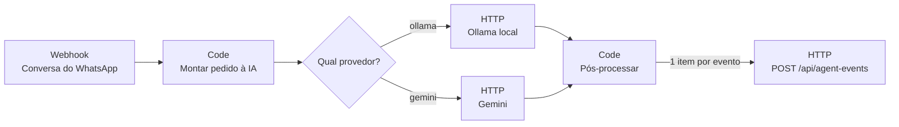

# n8n — o "Vito" extraindo dados das conversas

Workflow que recebe uma conversa de WhatsApp, pede à IA os eventos do contrato (§8.1/§8.2) e envia
cada um ao endpoint `POST /api/agent-events` do sistema. O **provedor é escolhido por conversa**
(campo `provider`) ou pelo padrão `VITO_PROVIDER` (D42):

| Provedor | Quando usar | Custo | Dados |
|---|---|---|---|
| **Gemini** (`gemini-3.5-flash`) | demonstração, melhor qualidade | plano gratuito (com limite) | saem para o Google — **só dados fictícios** |
| **Ollama** (`qwen2.5:7b`, local) | produção com dados reais (LGPD) | só o computador da loja | **não saem da máquina** |



## Uma única fonte de verdade

`workflows/vito-extracao.json` é **gerado** por `npx tsx scripts/gerar-workflow-n8n.ts`:

- o nó **Montar pedido à IA** traz o `buildPrompt` de `lib/agent/prompt.ts` e o JSON Schema derivado
  do contrato zod (`lib/agent/schema.ts`) — o mesmo para Gemini (`responseJsonSchema`) e Ollama (`format`);
- o nó **Pós-processar** traz o `postProcess` de `lib/agent/extraction.ts` (validação evento a
  evento, telefone vindo do metadado e nunca do texto, confiança recalculada).

Mudou o prompt ou o contrato? Gere de novo e reimporte. O banco de testes
(`scripts/avaliar-extracao.ts`, resultado em `docs/AVALIACAO_IA.md`) usa exatamente o mesmo código.

## Subir

```bash
cp infra/n8n/.env.example infra/n8n/.env      # ajuste VITO_APP_URL / modelos
docker compose -f infra/n8n/docker-compose.yml up -d
# abra http://localhost:5678 e crie a conta de dono (fica só no volume local)
```

Sem Docker: `npx n8n` funciona igual — defina antes as mesmas variáveis `VITO_*` e
`N8N_BLOCK_ENV_ACCESS_IN_NODE=false`, e use `localhost` no lugar de `host.docker.internal`.

Ollama (opcional, para o provedor local):

```bash
ollama pull qwen2.5:7b      # ~4,7 GB; qwen2.5:3b (~1,9 GB) é mais leve, porém erra mais
```

## Importar e configurar

1. **Workflows → Import from File** → `infra/n8n/workflows/vito-extracao.json`.
2. Crie duas credenciais do tipo **Header Auth** (os segredos ficam só no n8n, nunca no JSON):
   - *Gemini*: nome `x-goog-api-key`, valor = sua chave do Google AI Studio → selecione no nó **Gemini**;
   - *Sistema Virtù*: nome `Authorization`, valor = `Bearer <AGENT_API_TOKEN>` → selecione no nó
     **Enviar ao sistema**.
3. Ative o workflow.

## Testar

```bash
curl -X POST http://localhost:5678/webhook/vito-conversa \
  -H "content-type: application/json" -d @infra/n8n/exemplo-conversa.json
```

A resposta é imediata (o WhatsApp exige resposta rápida); o resultado aparece em **Executions** no
n8n e no sistema: cliente provisório, orçamento e agendamento aplicados, ou itens na **Revisão**
quando a confiança é baixa ou o evento mexe com dinheiro. Reenviar a mesma conversa com o mesmo
`conversation_id` não duplica nada: o endpoint responde `duplicate` (idempotência por `event_id`).

## Segurança

- Porta publicada só em `127.0.0.1` (o n8n não fica exposto na rede).
- Nenhuma chave no repositório: `infra/n8n/.env` é ignorado pelo git e as chaves ficam nas credenciais.
- O endpoint revalida tudo (token, tamanho, contrato zod) — o n8n não é confiável por padrão.
- Com o Gemini, só conversas fictícias (o plano gratuito pode usar os dados para treino).
