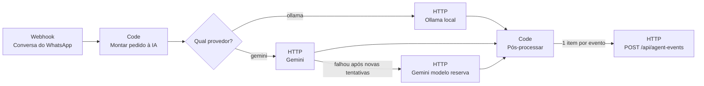
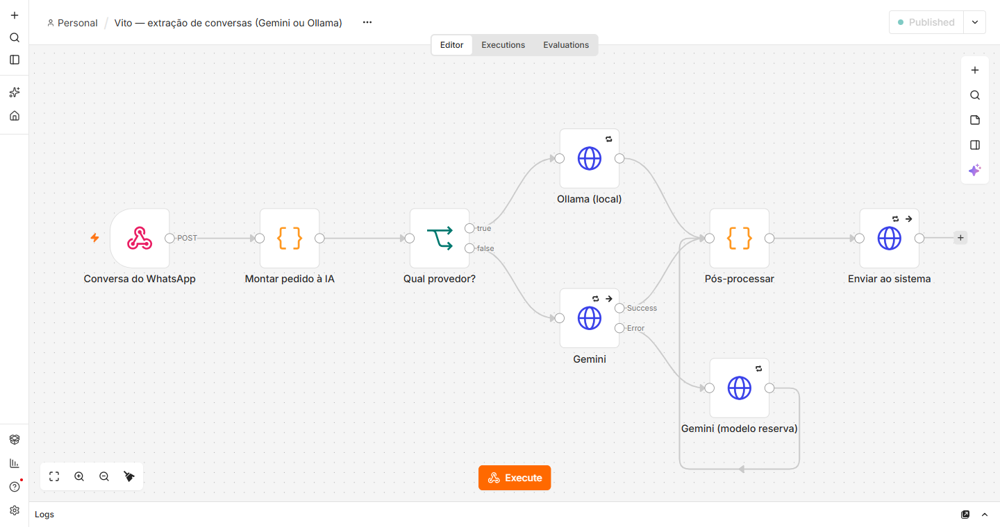
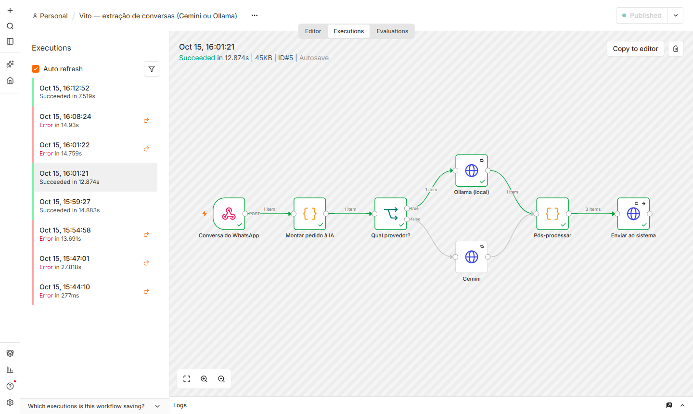
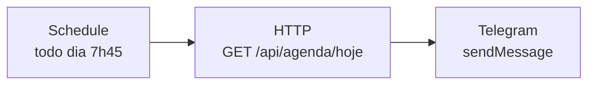
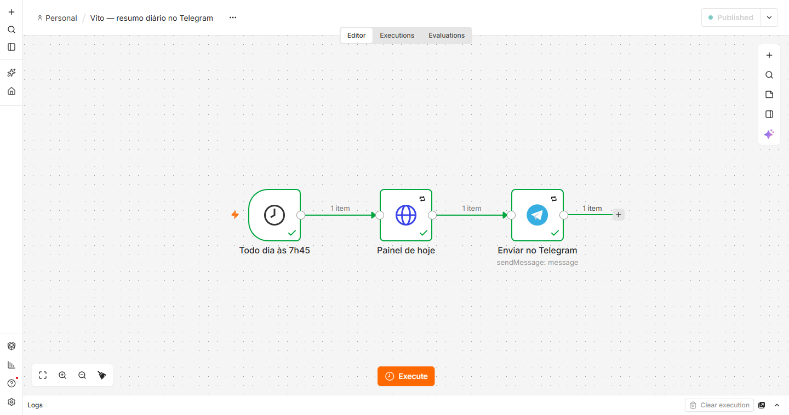
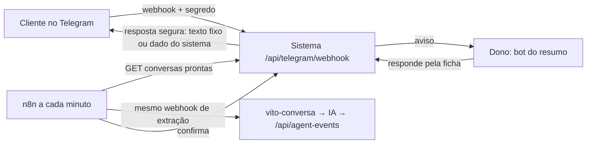

# n8n — o "Vito" extraindo dados das conversas (e o resumo do dia)

Dois workflows, ambos gerados por `npx tsx scripts/gerar-workflow-n8n.ts`:

- `workflows/vito-extracao.json` — conversa do WhatsApp → IA → eventos no sistema (abaixo);
- `workflows/vito-resumo-diario.json` — todo dia às 7h45, o resumo do painel "Hoje" no Telegram
  ([seção própria](#resumo-diário-no-telegram));
- `workflows/vito-telegram-extracao.json` — a cada minuto, as conversas do **bot da oficina** no
  Telegram vão para a mesma extração ([seção própria](#conversas-do-telegram-com-clientes)).

Workflow que recebe uma conversa de WhatsApp, pede à IA os eventos do contrato (§8.1/§8.2) e envia
cada um ao endpoint `POST /api/agent-events` do sistema. O **provedor é escolhido por conversa**
(campo `provider`) ou pelo padrão `VITO_PROVIDER` (D42):

| Provedor | Quando usar | Custo | Dados |
|---|---|---|---|
| **Gemini** (`gemini-3.5-flash`) | demonstração, melhor qualidade (90–98% no banco de testes) | plano gratuito (com limite) | saem para o Google — **só dados fictícios** |
| **Ollama** (`llama3.2:3b`, local) | dados reais (LGPD); acerta menos (61%), mas o que erra vai para a revisão | só o computador da loja | **não saem da máquina** |





## Uma única fonte de verdade

`workflows/vito-extracao.json` é **gerado** por `npx tsx scripts/gerar-workflow-n8n.ts`:

- o nó **Montar pedido à IA** traz o `buildPrompt` de `lib/agent/prompt.ts` e o JSON Schema derivado
  do contrato zod (`lib/agent/schema.ts`) — o mesmo para Gemini (`responseJsonSchema`) e Ollama (`format`);
- o nó **Pós-processar** traz o `postProcessLite` de `lib/agent/refine.ts`: lastro na conversa,
  confiança recalculada, telefone vindo do metadado e nunca do texto. É o mesmo núcleo do
  `postProcess` do banco de testes, só que **sem zod**: o sandbox do n8n desativa
  `Object.defineProperty`, de que o zod depende (D50). A validação completa do contrato fica com o
  endpoint, que recebe um evento por requisição. Um teste garante que as duas versões geram os
  mesmos eventos.

Se o Gemini continuar falhando após as novas tentativas (429/503 do plano gratuito), a saída de erro
do nó leva ao **modelo reserva** (`VITO_GEMINI_FALLBACK_MODEL`). O evento registra o modelo que de
fato respondeu.

Mudou o prompt ou o contrato? Gere de novo e reimporte. O banco de testes
(`scripts/avaliar-extracao.ts`, resultado em `docs/AVALIACAO_IA.md`) usa exatamente o mesmo código.

## Subir

```bash
cp infra/n8n/.env.example infra/n8n/.env      # ajuste VITO_APP_URL / modelos
docker compose -f infra/n8n/docker-compose.yml up -d
# abra http://localhost:5678 e crie a conta de dono (fica só no volume local)
```

> No Windows, instalar o n8n pelo npm falhou ao compilar uma dependência nativa (`isolated-vm`
> exige o Visual Studio Build Tools); por isso o caminho testado é o Docker.

Ollama (opcional, para o provedor local):

```bash
ollama pull llama3.2:3b     # ~2 GB; o melhor local no banco de testes (docs/AVALIACAO_IA.md)
```

## Importar e configurar

**Pela interface:** *Workflows → Import from File* → `infra/n8n/workflows/vito-extracao.json`; crie
duas credenciais do tipo **Header Auth** e selecione nos nós (os segredos ficam só no n8n):

- *Gemini (x-goog-api-key)*: nome `x-goog-api-key`, valor = chave do Google AI Studio → nós **Gemini**
  e **Gemini (modelo reserva)**;
- *Sistema Virtù (Bearer)*: nome `Authorization`, valor = `Bearer <AGENT_API_TOKEN>` → nó
  **Enviar ao sistema**.

Depois, publique (ative) o workflow.

**Pela linha de comando** (foi assim que testei): o workflow já referencia as credenciais pelos ids
`vitoGeminiKey001` e `vitoAgentToken01`. Crie um `creds.json` **fora do repositório**:

```json
[
  { "id": "vitoGeminiKey001", "name": "Gemini (x-goog-api-key)", "type": "httpHeaderAuth",
    "data": { "name": "x-goog-api-key", "value": "<chave>" } },
  { "id": "vitoAgentToken01", "name": "Sistema Virtù (Bearer)", "type": "httpHeaderAuth",
    "data": { "name": "Authorization", "value": "Bearer <AGENT_API_TOKEN>" } }
]
```

```bash
C=$(docker compose -f infra/n8n/docker-compose.yml ps -q n8n)
docker cp creds.json $C:/tmp/creds.json && rm creds.json
docker cp infra/n8n/workflows/vito-extracao.json $C:/tmp/wf.json
docker exec $C n8n import:credentials --input=/tmp/creds.json   # o n8n criptografa ao importar
docker exec $C n8n import:workflow --input=/tmp/wf.json
docker exec $C n8n publish:workflow --id=vitoExtracao0001
docker exec -u root $C rm -f /tmp/creds.json /tmp/wf.json
docker compose -f infra/n8n/docker-compose.yml restart
```

(No Git Bash do Windows, rode antes `export MSYS_NO_PATHCONV=1`, senão os caminhos `/tmp/...`
viram caminhos do Windows.)

## Testar

```bash
curl -X POST http://localhost:5678/webhook/vito-conversa \
  -H "content-type: application/json" -d @infra/n8n/exemplo-conversa.json
```

Para escolher o provedor, mude `"provider"` no JSON (`"gemini"` ou `"ollama"`). A resposta é
imediata (o WhatsApp exige resposta rápida); o resultado aparece em **Executions** no n8n e no
sistema: cliente provisório, orçamento e agendamento aplicados, ou itens na **Revisão**
quando a confiança é baixa ou o evento mexe com dinheiro. Reenviar a mesma conversa com o mesmo
`conversation_id` não duplica nada: o endpoint responde `duplicate` (idempotência por `event_id`).

## Segurança

- Porta publicada só em `127.0.0.1` (o n8n não fica exposto na rede).
- Nenhuma chave no repositório: `infra/n8n/.env` é ignorado pelo git e as chaves ficam nas credenciais.
- O endpoint revalida tudo (token, tamanho, contrato zod) — o n8n não é confiável por padrão.
- Com o Gemini, só conversas fictícias (o plano gratuito pode usar os dados para treino).

## Resultado do teste ponta a ponta (15/10/2026)

Conversa de `exemplo-conversa.json` (Tiago, alinhamento do HB20, "amanhã às 8h"), com o sistema
rodando localmente e o mesmo banco do Neon:

| Provedor | Eventos aplicados | Tempo |
|---|---|---|
| Gemini (o principal estava sem cota; respondeu o reserva `gemini-3.5-flash-lite`) | cliente, veículo, orçamento de R$ 90 e agendamento para o dia seguinte às 8h | ~8 s |
| Ollama `llama3.2:3b` | cliente, veículo e orçamento (não extraiu o agendamento) | ~13 s |

| Gemini → modelo reserva → 4 eventos enviados | Ollama → 3 eventos enviados |
|---|---|
|  |  |

As execuções com erro na lista são da depuração descrita nas D50 e D51. Esse teste também revelou uma condição de corrida no endpoint quando vários eventos da mesma
conversa chegam juntos, já corrigida (D51).

## Resumo diário no Telegram



O sistema devolve as contagens **e a mensagem pronta** (`lib/rules/digest.ts`, com testes): o n8n só
agenda e entrega. A mensagem leva nomes e motivos, **nunca telefone ou e-mail** (minimização, LGPD),
e mostra no máximo 5 itens por seção.

Configuração:
1. No Telegram, crie um bot com o **@BotFather** (`/newbot`) e mande um "oi" para ele.
2. Descubra o seu chat id: `https://api.telegram.org/bot<TOKEN>/getUpdates` → `message.chat.id`.
3. Em `infra/n8n/.env`: `VITO_TELEGRAM_CHAT_ID=<chat id>` e `VITO_APP_URL` apontando para o
   sistema (a demo: `https://virtu-pneus-central.vercel.app`).
4. Credencial do tipo **Telegram API** com o token, selecionada no nó **Enviar no Telegram** — pela
   interface ou pela linha de comando, com o id `vitoTelegramBot01`:
   `[{"id":"vitoTelegramBot01","name":"Telegram (bot do resumo)","type":"telegramApi","data":{"accessToken":"<TOKEN>"}}]`
5. Importe e publique `vito-resumo-diario.json` (`--id=vitoResumoDiario01`). O fuso do agendamento
   fica nas configurações do workflow (`America/Sao_Paulo`).

Para testar sem esperar as 7h45: abra o workflow e use **Execute workflow**. (Pela linha de comando,
`n8n execute` não serve: ele exige um gatilho manual.)



## Conversas do Telegram com clientes

O cliente conversa com o **bot da oficina** (separado do bot do resumo). Quem recebe as mensagens é
o **sistema na Vercel** (`/api/telegram/webhook`), que precisa de endereço público com HTTPS — o
n8n local não precisa ficar exposto. O sistema responde só o que é seguro (D57) e guarda a conversa;
o n8n só leva as conversas prontas para a extração:



Configuração:
1. **@BotFather** → `/newbot` (o bot da oficina). Token em `.env.local`:
   `TELEGRAM_CLIENTE_BOT_TOKEN`; segredo do webhook (aleatório) em `TELEGRAM_WEBHOOK_SECRET`;
   opcionais `SHOP_NAME`, `SHOP_ADDRESS`, `SHOP_HOURS` (os padrões dizem que são fictícios).
2. As mesmas variáveis na Vercel (produção), mais `TELEGRAM_BOT_TOKEN` e `TELEGRAM_CHAT_ID` do bot
   do resumo, para avisar o dono de mensagens novas.
3. Registrar o webhook e a descrição do bot:
   `npx tsx --env-file=.env.local scripts/telegram-webhook.ts`
4. Importar e publicar `vito-telegram-extracao.json` (`--id=vitoTelegramExtracao1`), que usa a
   credencial *Sistema Virtù (Bearer)* e o webhook do workflow de extração desta mesma instância.
